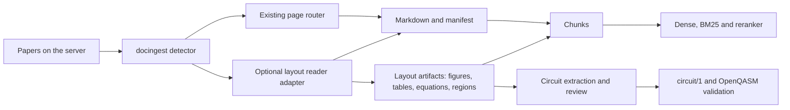

# Multimodal reading: design proposal

**Status: design proposal.** Nothing here is shipped. It records an audit of the current pipeline
and a plan to add an optional multimodal document reader behind an adapter. It comes from the
design notes of LaloAsetsu, cleaned up and fitted to the current code. The circuit
side is in [circuit-retrieval-and-assembly.md](circuit-retrieval-and-assembly.md). A measured
comparison of the two OCR paths is in
[packages/docingest/docs/ocr-implementation-comparison.md](../packages/docingest/docs/ocr-implementation-comparison.md).

## Audit of the current pipeline

`docingest` already provides:

- per-page PDF routing between the text layer, blank-page detection and VLM OCR;
- content-addressed normalized Markdown plus a `manifest.json` with provenance;
- page-aware overlapping chunks;
- dense retrieval, BM25 fusion and a cross-encoder reranker;
- whole-block completion for equations, tables and circuit code;
- deterministic LaTeX circuit reading into `circuit/1`, validated by `quantum-sim`.

The index is simple on purpose: float16 vector shards, exact cosine search and Tantivy for the
keyword side. The main accuracy risks are layout reduced to Markdown, no metadata filters at search
time, and scanned diagrams with no recoverable LaTeX.

The API database (SQLite) holds accounts, sessions, the question-set catalog and benchmark jobs.
It has no circuit table, and circuits are read on demand from `document.md`. The first version of this proposal added a
`circuits.json` file per document. It was dropped, for the reasons given in the circuit note.

## An optional layout reader

MinerU 4, driven through `mineru-kit`, is a candidate for splitting PDFs, Office files and images
into text, tables, equations and figures. It should be one optional `DocumentConverter` adapter,
chosen in the configuration, off by default, and never a replacement for the per-page OCR route.
The adapter would depend on `mineru>=4.0.12,<5` directly, and not on `raganything` or `lightrag`,
which downgrade pandas for the whole workspace and pull in about 60 packages. The workspace lock
(pandas included) must not change.

The adapter should:

- import its library only when selected, and fail with a clear message when it is missing;
- expose a fingerprint with the package version, parser settings and model revisions;
- keep source page, region, figure and table identifiers in the conversion result;
- write one `Segment` per page with real `source_pages`, and document `LayoutArtifact.page` as
  0-based;
- choose the OCR mode per page, never with `any()` over the whole PDF;
- use a work folder keyed by `doc_id`, write into a temp folder renamed at the end, and never fall
  back to "any JSON" found in the folder;
- map a subprocess timeout to `ConversionError`, and resolve the binary next to `sys.executable`;
- leave LaTeX and plain text to their native converters, falling back to `ingest()` on
  `ConversionError`;
- write no network-backed state;
- reject unclear extraction instead of turning it into runnable circuit data.

Keeping raw parser output would add a new `raw_artifacts` field to `manifest.json` and a new stored
file, so both need the lead's approval and stay off by default. If approved, the manifest would list
the file name in `raw_artifacts`, and the file would be written atomically beside `document.md` and
limited to a configured size.

### Licenses

MinerU is optional and off by default. Two points decide whether it may be used:

- MinerU 4.0.12 is published under a MinerU license: Apache-2.0 plus extra terms. It is not an OSI
  license. The terms ask a service offered to third parties to say that it uses MinerU, set
  commercial-use thresholds and end the license automatically if the terms are broken. Our API and
  web app are such a service, so the attribution note is required.
- The weights are downloaded separately on first use. `MinerU2.5-Pro-2604-1.2B` is Apache-2.0.
  `MinerU2.5-2509-1.2B` is AGPL-3.0. Only the Apache-2.0 weights are acceptable, so the adapter
  must pin the Pro revision and refuse the others.

The other new packages that the first version added to the lock file are MIT, BSD, Apache-2.0 or
PSF-2.0. Before the adapter is merged, its pull request must carry a licenses section in the
configuration reference with the MinerU license, the weights per tier with license and pinned
revision, and the attribution note, and the lead must approve it.

## Target flow

The diagram shows where an optional reader would sit. The solid path exists today. The reader and
the layout artifacts are the proposal.



Paths must be passed in explicitly, not assumed to be under `data/raw`:

```bash
export RESEARCH_ENGINE_INPUT=/srv/research/papers
export RESEARCH_ENGINE_CONFIG=/srv/research/pipeline.toml

uv run docingest ingest "$RESEARCH_ENGINE_INPUT" \
  --config "$RESEARCH_ENGINE_CONFIG" --index
```

The output folder is `output_dir` in the config file (and `raw_dir` if needed), not an
environment variable.

The service account needs read access to the input folder and read and write access to the output,
the index and the model cache. In a container, mount these folders at the same paths.

## Circuit extraction: what to specify

Inputs are LaTeX circuit blocks, figure regions found by the layout reader, and OCR or vision
observations with boxes, wires, labels, gate names and parameter text, each with its citation
(document, page, region, span).

Each observation would carry:

| Field | Requirement |
|---|---|
| `kind` | gate, wire, control, measurement, parameter, phase-shift-factor or text |
| `label` | Original OCR or LaTeX spelling |
| `normalized_label` | Canonical name, when it is unambiguous |
| `wires` | 1-based wire numbers, or an unresolved marker |
| `parameters` | Symbolic expressions and normalized angle expressions |
| `confidence` | A number, plus the model or parser that produced it |
| `source` | Document, page, region and span |
| `review_status` | `accepted`, `needs_review` or `rejected` |

Acceptance rules:

1. Keep the original observations even when the circuit is rejected.
2. Never infer wire order, gate arity or phase meaning from a low-confidence image alone.
3. Emit `circuit/1` only when every wire and operation is resolved.
4. Emit OpenQASM only after the schema and the simulator checks pass.
5. Keep phase-shift factors as explicit symbolic metadata. Fold one into a gate only when the
   source or a deterministic rule proves it equivalent.
6. Keep the validation output, parser version, model revision and artifact hash with the record.

## Rollout and measurements

1. Measure the current retrieval and circuit results as a baseline.
2. Add layout metadata and the optional adapter without changing default output.
3. Add filtered retrieval.
4. Compare figure extraction with checked-in fixtures and hand-reviewed samples.
5. Turn the adapter on only in configurations that declare its dependencies and cache paths.

Track retrieval recall and precision, ingestion speed, OCR rejection rate, how many circuits are
structurally accepted, phase-shift-factor precision, and the share of accepted circuits that
`quantum-sim` validates.
