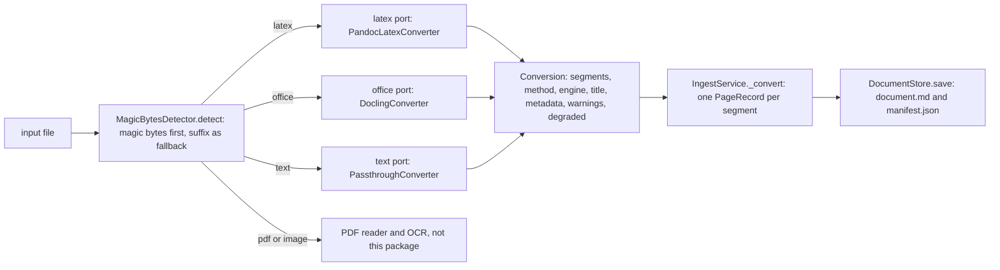
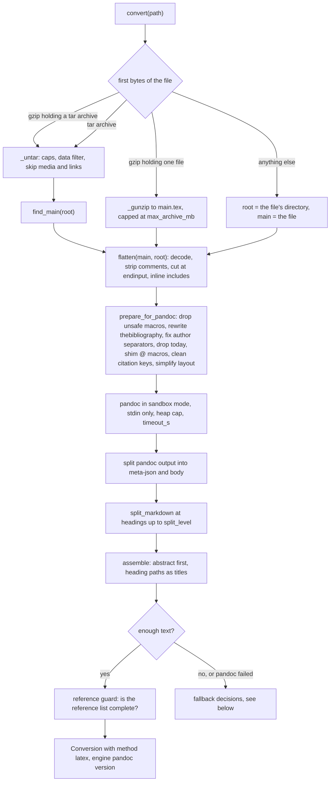
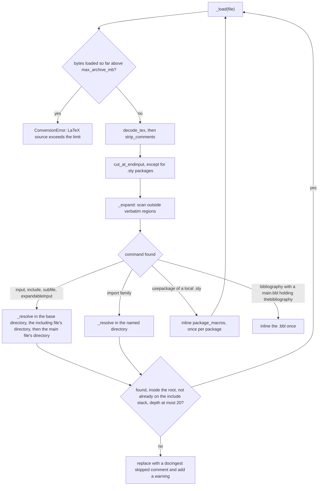
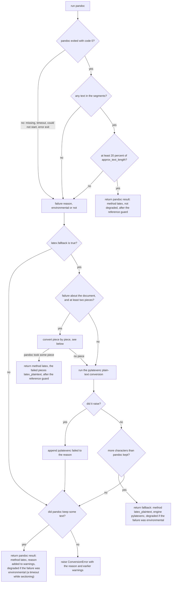

# Document converters (`docingest.adapters.converters`)

This package holds the implementations of the `DocumentConverter` port: the code that turns a whole document that is not a PDF or an image (a LaTeX source, an office or HTML file, a Markdown or text file) into a list of Markdown segments. PDFs and images do not come here; they go through the PDF reader and the OCR engines (see [../ocr/README.md](../ocr/README.md)).

| File | Contents | Port (`[adapters]` key) | Adapter name |
| --- | --- | --- | --- |
| [`pandoc_latex.py`](pandoc_latex.py) | `PandocLatexConverter`: LaTeX to Markdown with a sandboxed pandoc, a pylatexenc plain-text fallback, section splitting and metadata extraction | `latex` | `pandoc` |
| [`latex_source.py`](latex_source.py) | Pure helpers used by `PandocLatexConverter`: safe archive unpacking, main-file detection, decoding, comment stripping, flattening of includes, macro hygiene, the source rewrites pandoc needs, brace matching, section splitting. No pandoc and no pylatexenc in this module | (helpers) | (helpers) |
| [`docling.py`](docling.py) | `DoclingConverter`: DOCX, PPTX, XLSX and HTML through Docling (`office` extra) | `office` | `docling` |
| [`plaintext.py`](plaintext.py) | `PassthroughConverter`: Markdown and plain text, unchanged | `text` | `passthrough` |

Related documentation: the port definitions are in [../../ports/README.md](../../ports/README.md), the adapter catalogue in [../README.md](../README.md), the ingestion use case in [../../application/README.md](../../application/README.md), configuration in [../../../../config/README.md](../../../../config/README.md), and the decision to prefer LaTeX sources for arXiv papers in [ADR 0003](../../../../docs/adr/0003-latex-first-for-arxiv.md).

## Contents

- [How a document reaches a converter](#how-a-document-reaches-a-converter)
- [The port: Conversion and Segment](#the-port-conversion-and-segment)
- [What ingestion does with a Conversion](#what-ingestion-does-with-a-conversion)
- [LaTeX: PandocLatexConverter](#latex-pandoclatexconverter)
  - [Accepted inputs and the conversion path](#accepted-inputs-and-the-conversion-path)
  - [Step 1: safe unpacking](#step-1-safe-unpacking)
  - [Step 2: main-file detection](#step-2-main-file-detection)
  - [Step 3: decoding and comments](#step-3-decoding-and-comments)
  - [Step 4: flattening](#step-4-flattening)
  - [Step 5: source rewrites before pandoc](#step-5-source-rewrites-before-pandoc)
  - [Step 6: sandboxed pandoc](#step-6-sandboxed-pandoc)
  - [Step 7: section splitting](#step-7-section-splitting)
  - [Fallback decisions and the degraded flag](#fallback-decisions-and-the-degraded-flag)
  - [The pylatexenc plain-text fallback](#the-pylatexenc-plain-text-fallback)
  - [Brace handling and linear-time scanning](#brace-handling-and-linear-time-scanning)
  - [Configuration: the latex section](#configuration-the-latex-section)
  - [Warnings and errors](#warnings-and-errors)
- [Office and HTML: DoclingConverter](#office-and-html-doclingconverter)
- [Markdown and text: PassthroughConverter](#markdown-and-text-passthroughconverter)
- [PDFs and images: MineruConverter](#pdfs-and-images-mineruconverter)
- [Using a converter directly](#using-a-converter-directly)
- [Adding or changing a converter](#adding-or-changing-a-converter)
- [Tests](#tests)

## How a document reaches a converter

The type detector decides the `SourceKind` of each input. For the three kinds handled here, the container looks up the configured adapter name for that kind's port and builds the converter only when the first document of that kind shows up (`_LazyConverters` in [`bootstrap.py`](../../bootstrap.py)). The diagram shows that path and what comes out of it.



Routing by kind (detection rules live in `adapters/detection/magic.py`):

| `SourceKind` | Detected when | `[adapters]` key | Default adapter | `PageMethod` values produced |
| --- | --- | --- | --- | --- |
| `latex` | suffix `.tex` or `.ltx`, or the bytes are a tar archive (any file name), or a gzip stream holding a tar archive or a single `.tex` file | `latex` | `pandoc` | `latex`, or `latex_plaintext` after the fallback (a single section can fall back alone, see [section by section](#section-by-section-and-the-reference-guard)) |
| `office` | suffix `.docx`, `.pptx`, `.xlsx`, `.html`, `.htm` or `.xhtml` | `office` | `docling` | `docling` |
| `text` | suffix `.md`, `.markdown` or `.txt` | `text` | `passthrough` | `passthrough` |

A gzip stream that holds a PDF, PostScript or HTML is rejected by the detector with `UnsupportedInputError`, as is any file whose type is not recognised.

## The port: Conversion and Segment

The port is defined in [`ports/converters.py`](../../ports/converters.py). `DocumentConverter` is a `typing.Protocol` with two members:

| Member | Meaning |
| --- | --- |
| `fingerprint: str` | Name, version and settings of the converter. It is the only adapter-specific part of the cache key of `latex`, `office` and `text` documents, so it must change whenever the output can change. |
| `convert(path: Path) -> Conversion` | Convert one file. Must raise `ConversionError` (from `domain/errors.py`) when the document cannot be converted. |

`Segment` (frozen dataclass): one logical unit of a converted document, such as a section, a slide or the whole file.

| Field | Type | Meaning |
| --- | --- | --- |
| `text` | `str` | Markdown of the segment, including its own heading line when it has one. |
| `title` | `str \| None` (default `None`) | Heading path of the segment, for example `"Method > Complexity"`. `None` for untitled content. |
| `method` | `PageMethod \| None` (default `None`) | Only for a segment made differently from the rest of its conversion: a LaTeX section that fell back to plain text (`latex_plaintext`). The segment's page record takes it instead of the conversion's `method`. |
| `warnings` | `tuple[str, ...]` (default `()`) | The notes that belong to this segment alone, such as why its section fell back to plain text. They become the `warnings` of its page record. |

`Conversion` (frozen dataclass): the result of one `convert()` call.

| Field | Type | Default | Meaning |
| --- | --- | --- | --- |
| `segments` | `list[Segment]` | required | The document, in order. |
| `method` | `PageMethod` | required | How the text was produced: `latex`, `latex_plaintext`, `docling` or `passthrough`. |
| `engine` | `str` | required | Tool and version that produced the text, for example `"pandoc 3.9"`, `"pylatexenc 2.11"`, `"docling 2.130.0"`, `"passthrough"`. |
| `title` | `str \| None` | `None` | Document title found by the converter. |
| `metadata` | `SourceMetadata \| None` | `None` | Bibliographic metadata found by the converter (title, authors, abstract). |
| `warnings` | `list[str]` | `[]` | Human-readable notes about anything skipped, ignored or degraded. |
| `degraded` | `bool` | `False` | `True` when a fallback ran because of the environment (a timeout, a crash, a missing tool) rather than the document. Such a result must not be cached as the canonical conversion. |

## What ingestion does with a Conversion

`IngestService._convert()` in `application/ingest.py` consumes the `Conversion`:

1. Every warning is logged as `  warning: <text>`.
2. With `--max-pages N`, only the first `N` segments are kept. The manifest still records the total in `source_pages`.
3. Each kept segment becomes one `PageRecord` with the segment's `method` (the conversion's `method` when the segment has none) and `warnings`, the conversion's `engine`, the segment's `title`, `n_chars = len(text)`, and `seconds` = conversion time divided by the number of kept segments.
4. The manifest title is the first one available of: the title in external metadata (a `<file>.meta.json` sidecar or the arXiv crawler), the conversion's `title`, the file stem. External metadata also takes precedence over the conversion's `metadata`.
5. `document.md` is written as `# <title>` followed by one `<!-- page N | method=<method> -->` marker and the segment text per segment.
6. If `degraded` is true, the service logs a warning and the store writes the result under `<output_dir>/_degraded/`, where the cache lookup never reads. The next run tries the converter again.

The cache key of a converted document is a hash of `PIPELINE_VERSION` (in `application/ingest.py`), the source kind, the `ocr_all` flag (always false for these kinds) and the converter's `fingerprint`.

## LaTeX: PandocLatexConverter

`PandocLatexConverter(cfg: LatexConfig | None = None)` converts LaTeX sources, typically arXiv e-prints, into one segment per section. The main module is [`pandoc_latex.py`](pandoc_latex.py); all file-system and text handling that happens before pandoc runs is in [`latex_source.py`](latex_source.py).

pandoc is not trusted with the file system. The module docstring of `latex_source.py` lists why: pandoc resolves `\input` against its working directory, silently drops included files that are not UTF-8, hangs on a file that inputs itself or on a self-referential macro (conference style files do `\renewcommand{\small}{\@setfontsize\small...}`), and reads any path it is given (`\lstinputlisting{/etc/passwd}` ends up in the Markdown). The converter therefore unpacks archives itself, picks the main file, inlines every include in Python, and only then runs pandoc with `--sandbox` on one self-contained document.

### Accepted inputs and the conversion path

`unpack()` sniffs the first bytes, not the file name:

| Input | How it is recognised | What `unpack()` returns |
| --- | --- | --- |
| A `.tex` file | neither gzip nor tar | root = the file's own directory, main = the file. Nothing is copied |
| A tar archive | a valid first tar header (ustar, or pre-POSIX v7 with a correct checksum) | the extracted tree, main to be detected |
| A gzipped tar archive (arXiv source archives) | gzip magic `1f 8b` and a valid tar header in the first decompressed block | the extracted tree, main to be detected |
| A single gzipped `.tex` (old arXiv e-prints) | gzip magic without a tar header inside | `main.tex` in the work directory |

Everything is extracted into a fresh `tempfile.TemporaryDirectory(prefix="docingest-latex-")`, which is deleted when `convert()` returns. The diagram shows the whole path of one LaTeX conversion.



### Step 1: safe unpacking

`unpack(path, dest, max_bytes=...)` and `_untar()` bound every resource an archive could exhaust:

| Guard | Limit | Behaviour |
| --- | --- | --- |
| Total unpacked size | `max_archive_mb` from `[latex]` (default 200 MB) | Summed from the tar headers while they are read, before anything is extracted. Exceeding it raises `ConversionError("<name> unpacks to more than 200 MB (max_archive_mb)")`. A single gzipped `.tex` is decompressed in 1 MiB chunks and stopped at the same limit. |
| Number of members | `MAX_MEMBERS = 20_000` | More raises `ConversionError("<name> has more than 20000 files")`. |
| Size of one member's headers | `MAX_TAR_HEADER = 1 MiB` | `_CappedReader` wraps the stream and refuses any read larger than the remaining room before it decompresses or allocates, so a pax or GNU long-name header bomb (a few hundred KB of gzip that expand into a huge header) is refused instead of loaded into memory. |
| Member types | regular files only | Links, devices and directories are never extracted. |
| Member names | tarfile's `data` filter | Each member is checked with `tarfile.data_filter()` first. A member the filter refuses (for example a `..` path that would land outside the extraction directory) is skipped with a warning. Extraction itself also uses `filter="data"`, which strips the leading `/` of an absolute name, so such a member lands inside the extraction directory. |
| Media and binaries | `_MEDIA_SUFFIXES` | Files with these suffixes are not extracted, because they are never needed for text: images (`.png`, `.jpg`, `.jpeg`, `.gif`, `.bmp`, `.tif`, `.tiff`, `.webp`, `.svg`, `.ai`, `.psd`), `.eps`, `.ps`, `.pdf`, video (`.mp4`, `.mov`, `.avi`), nested archives (`.zip`, `.gz`, `.tgz`, `.tar`, `.bz2`, `.xz`, `.7z`), data and model files (`.npy`, `.npz`, `.pkl`, `.pt`, `.pth`, `.ckpt`, `.h5`, `.hdf5`, `.bin`, `.mat`) and office files (`.xlsx`, `.docx`, `.pptx`). |
| Memory | `MemoryError` | Turned into `ConversionError("cannot unpack <name>: out of memory")`. |
| Corrupt input | tar, gzip, zlib, EOF and OS errors | Turned into `ConversionError("cannot unpack <name>: ...")` or `ConversionError("corrupt gzip file <name>: ...")`. |

### Step 2: main-file detection

For archives, `find_main(root)` picks the file to compile, the way arXiv does. It considers files with the suffix `.tex` or `.ltx` whose relative path has no component starting with `.` or `__MACOSX` (no hidden file, no file inside a hidden directory or a `__MACOSX` folder), and decides in this order:

1. **README hint.** `00README.json` with a `sources` entry whose `usage` is `"toplevel"` (its `filename` is used), or a legacy `00README.XXX` file with a line `<file> toplevelfile`. The hinted file must exist inside the root.
2. **Candidate pool.** Files with `\documentclass` (or `\documentstyle`) and `\begin{document}`, excluding the `standalone` and `subfiles` classes. If there are none: the same files including those classes. If still none: any file with `\documentclass`. If still none: every `.tex` file. A pool of one is the answer.
3. **Conventional name.** Among the pool, a file named `main`, `ms`, `paper` or `article` (the shallowest one, ties broken in that order).
4. **Not included by another file.** Files that no other file pulls in with `\input`, `\include`, `\subfile` or `\import`.
5. **Largest file.** If several remain, the largest one wins and the warning `several main-file candidates; picked the largest (<name>) over <others>` is added.

No `.tex` file at all raises `ConversionError("no .tex file in the LaTeX source")`.

### Step 3: decoding and comments

Every file is read through `decode_tex(data)`, which never fails:

- A UTF-8 byte-order mark is dropped.
- Valid UTF-8 is decoded as UTF-8.
- A file with some real UTF-8 but a few stray bytes that are not UTF-8 (a pasted latin-1 no-break space, for example) keeps its UTF-8 characters, and only the stray bytes are read as cp1252 (or latin-1 for the five bytes cp1252 leaves undefined). The error handler is registered as `docingest-legacy`.
- A file without a single multi-byte UTF-8 sequence is a legacy file: cp1252, or latin-1 if it uses a byte cp1252 leaves undefined.
- Newlines are normalised to `\n`.

`strip_comments(text)` then removes `%` comments like TeX does:

- A line that holds only a comment disappears entirely.
- A trailing comment is removed but its `%` is kept, so TeX's "no space at the end of this line" meaning survives.
- `\%` is text. A `%` inside a verbatim-like environment (`verbatim`, `Verbatim`, `BVerbatim`, `LVerbatim`, `lstlisting`, `minted`, `comment`, with or without `*` where applicable), inside a `\verb`-like argument (`\verb`, `\lstinline`, `\Verb`, `\mintinline`, url's `\path`), or inside the argument of `\url{...}` or the URL argument of `\href{...}{...}` is text too.

### Step 4: flattening

`flatten(main, boundary, max_chars=..., max_depth=20)` returns a `Flattened(text, files, warnings)`: the whole document as one string, the list of inlined files relative to the root, and the warnings. The boundary is the root returned by `unpack()`: nothing outside it is ever read, whatever a path or a symlink says.

Each file goes through `_load()` (size accounting, `decode_tex`, `strip_comments`, `cut_at_endinput`) and then `_expand()`, which rewrites include commands outside verbatim regions only. The diagram follows one file.



Commands that are inlined:

| Command | Resolution | Notes |
| --- | --- | --- |
| `\input{x}`, `\input x`, `\subfile{x}`, `\expandableinput{x}` | Relative to the current base directory, then the including file's directory, then the main file's directory. `x.tex` is tried first, then `x` | Braced or bare argument. |
| `\include{x}` | As above, always `x.tex` | Surrounded by blank lines, because `\include` always starts a new page and therefore a new paragraph. |
| `\import{dir}{file}`, `\inputfrom`, `\includefrom` | `file` inside `dir` relative to the main file's directory | `dir` becomes the base directory for includes inside the imported file. The `\include...` variants get the paragraph break too. |
| `\subimport{dir}{file}`, `\subinputfrom`, `\subincludefrom` | `file` inside `dir` relative to the current base directory | Same base-directory and paragraph-break rules as the non-`sub` forms. |
| `\usepackage{a,b}` and `\RequirePackage{...}` | Each name as `name.sty` in the same three directories | A package found in the source tree is replaced by its notation macros (`package_macros()`, see step 5) and loaded once. Packages not found (system packages such as `amsmath`) stay in a `\usepackage` line, with the original options. |
| `\bibliography{...}` | `<main>.bbl` next to the main file | Inlined once, and only if it contains `thebibliography` (a biblatex `.bbl` is left alone). |

An included file that contains `\begin{document}` (a `\subfile`, a standalone figure) contributes only its body.

An include that cannot be inlined is replaced by the comment `%docingest: skipped (<reason>)`, and the warning `skipped <command> (<reason>)` is added:

| Reason | Cause |
| --- | --- |
| `unresolvable` | Empty name, or a name containing `#` or `\` (a macro argument). |
| `missing` | No such file in any searched directory. |
| `outside the source tree` | The resolved path is outside the boundary. |
| `recursive include` | The file is already on the include stack. |
| `nesting deeper than 20` | More than `MAX_DEPTH = 20` nested includes. |

The running total of bytes loaded (main file, includes, packages and the `.bbl`) is compared with `max_archive_mb`. Exceeding it raises `ConversionError("LaTeX source exceeds 200 MB (max_archive_mb)")`. A file that cannot be read (permissions, disk errors) surfaces from `convert()` as `ConversionError("cannot read LaTeX source <name>: ...")`.

#### `cut_at_endinput`

`cut_at_endinput(text, main=False)` returns the text as far as TeX reads it: up to the end of the line that holds the first `\endinput` TeX executes. The rest of that line is kept, everything after it is dropped, and the `\endinput` command itself is removed (pandoc would otherwise stop reading the whole flattened document there). An `\endinput` counts only when:

- it is at brace depth 0 (not inside a macro body such as `\newcommand{\stop}{\endinput}`),
- it is outside verbatim and `filecontents` environments and `\verb`-like arguments,
- it is not closed by a `\fi` on the same line within 200 characters (an include guard such as `\ifx\loaded\undefined\else\endinput\fi`),
- it is not the operand of `\let`, `\futurelet`, `\ifx`, `\noexpand`, `\string`, `\meaning` or `\show`,
- and, in the main file, it comes after the last `\end{document}` (LaTeX has to reach `\end{document}` first).

Local `.sty` packages are loaded without this cut.

### Step 5: source rewrites before pandoc

`prepare_for_pandoc(text)` makes pandoc's output complete and its run bounded:

| Rewrite | Why |
| --- | --- |
| `protect_circuits()` writes each quantum circuit as a `minted` listing in LaTeX holding the circuit's own source: `\begin{quantikz}`, `\Qcircuit ... {...}` (balanced braces), `\begin{yquant}` and `yquant*`, and a `tikzcd` that has circuit commands (`\gate`, `\ctrl`, `\targ`, `\qw`, `\meter`, `\lstick`, ...). It runs first, so the other rewrites see a listing | pandoc has no reader for these. With raw TeX off it drops the commands (`\gate{H}`, `\ctrl{1}`) and keeps the column separators, so a circuit came out as `& & &\` or as nothing, and inside `\resizebox`, `\scalebox` or a TikZ node it vanished. As a listing pandoc writes a fenced code block tagged `latex` (` ``` latex `) where the circuit was, before the caption of its figure. The source in the block is the circuit's text with comments already stripped, byte for byte: the rewrites below that read the whole text (`\vskip`, `\today`, `\And`, citation keys, `\label[type]`, ...) do not see it, because `prepare_for_pandoc()` swaps each listing body for a word first and puts it back last (`_hide_listings()`). pandoc expands tabs to the tab stop, and `assemble()` leaves the blank lines inside a fenced block alone (`collapse_blank_lines()`). See [Quantum circuits](#quantum-circuits) for what is left alone. |
| `drop_unsafe_macros()` removes top-level `\newcommand`, `\renewcommand`, `\providecommand`, `\DeclareRobustCommand`, `\DeclareMathOperator` and `\def` / `\gdef` / `\edef` / `\xdef` definitions that are self-referential (the body uses the macro's own name) or that redefine a structural command | pandoc expands a self-referential macro forever. A redefinition of a structural command (`section`, `title`, `author`, `caption`, `cite`, `begin`, `input` and the rest of `STRUCTURAL`) hides headings, titles or authors from pandoc. The warning `ignored N self-referential/structural macro(s): \a, \b` lists what was dropped. |
| `rewrite_bibliography()` turns each `thebibliography` environment into `\section*{References}` and an `enumerate` whose items start with `\cite{<key>}` | pandoc prints the widest-label argument as text, drops `\newblock {\em ...}` groups (the venue) and emits no heading. The citation key at the start of each item lets `[@key]` in the text be matched to its reference. Helper macros in natbib's preamble are kept, `\url`, `\doi`, `\href` and `\urlprefix` overrides are not. |
| `\And` and `\AND` become `\and` | NeurIPS and ICLR styles separate authors with them, pandoc only knows `\and`. |
| `\today` is removed | A sandboxed pandoc prints 1970-01-01. |
| `shim_at_macros()` drops definitions of `@`-named macros and replaces the few `@` bodies it can | pandoc 3.9 cannot read `\providecommand \@ifxundefined [1]{...}` (it reads `\@` and stops at `#1`), and the `.bbl` of REVTeX and natbib styles starts with such definitions, which `rewrite_bibliography()` keeps. A macro whose whole body is one internal gets the plain definition (`\bibinfo [0]{\@secondoftwo}` becomes `\providecommand{\bibinfo}[2]{#2}`; also `\@firstoftwo`, `\@gobble`, `\@gobbletwo`, `\@firstofone`). Other bodies that use an `@` stay, because dropping them lost tables and headings. In the preamble of a bibliography only (where `rewrite_bibliography()` calls it with `opaque=True`), a macro built on `\csname`, `\catcode` or `\spacefactor` (`\BibitemShut`) gets an empty body with the same arguments, or just the arguments it prints outside `\csname` and `\typeout` (IEEEtran's `\BIBforeignlanguage[2]` becomes `[2]{#2}`, so the title of an entry stays). Elsewhere in a document such a macro is left alone, because emptying it would delete its visible text. |
| `rewrite_bibliography()` also repairs REVTeX's reference entries | pandoc 3.9 drops the whole list, without an error, when an entry has `\href {url}` and its text on the next line, `\href@noop {}` (an entry without a URL) or the `\Eprint` helper (`\providecommand \Eprint [0]{\href }`). The arguments of `\href` are joined, `\href@noop {}` is removed and `\Eprint` is defined with its two arguments. These rewrites apply inside the bibliography only. |
| `sanitize_citation_keys()` cleans the keys of `\cite`-like commands (`\cite`, `\citep`, `\citet`, `\textcite`, `\autocite`, `\footcite`, `\nocite` and the other `\cite...` forms) | pandoc reads a key of letters (any script), digits and `_:.+/-`. An empty key (`\cite{a,,b}`) is dropped, braces are removed and any other character (`$`, a curly quote, a non-breaking hyphen, `\|`, a space) is written as `_x<hex code>_` (`a$b` becomes `a_x24_b`), so keys that differ only in such a character stay different. This holds except for a key that already contains the escape form itself (a literal `a_x24_b` collides with `a$b`). A `%` comment inside the key list is dropped, as TeX does. `\nocite{*}` is left alone. `rewrite_bibliography()` applies the same function to the key of each entry (`clean_citation_keys()`), so a citation and its reference keep matching. A command with no key left disappears. The definition of a citation macro (`\edef\citenum{...}`, `\newcommand\citep`) and a key that is a macro parameter (`\cite{#1}`) are left alone. |
| `simplify_layout()` | Small forms pandoc stops at or drops a float for: cleveref's `\label[type]{key}` becomes `\label{key}`; LyX's `\global\long\def` (up to four prefixes) becomes `\def`, and so does an `\edef` or `\xdef` with parameters (`\edef\x#1{...}`, which pandoc rejects; `\gdef` and a parameterless `\edef` or `\xdef` are read by pandoc with their meaning, and as `\def` the save-and-redefine idiom `\xdef\saved{\X}\renewcommand{\X}{[\saved]}` loops until the timeout); `\newcolumntype{X}[n]{spec}` is removed; `\raggedright` (in a caption pandoc 3.9 drops the whole table) and `\vskip <glue>` are removed; IEEEtran's `\linebreakand` becomes `\and`. |
| `number_equations()` writes the number LaTeX gives each numbered display equation into it as `\tag{n}`, and replaces `\eqref{key}` by `(n)` and `\ref{key}` by `n` when `key` labels one of those equations. It runs last, with the circuit listings hidden, so a circuit and any verbatim text is never read. See [Equation numbers](#equation-numbers) | pandoc keeps the math of `equation`, `align` and the others but not the number LaTeX shows beside it, and writes every `\ref` and `\eqref` as a link whose text is the label (`[\[eq:x\]](#eq:x)`). A reader who asks what "Eq. (7)" states finds neither the equation nor the 7. `\tag` is copied with the rest of the math on every path of the converter (pandoc on the whole paper, pandoc on a section, pylatexenc with the math verbatim). |

The rewrites target the reader of pandoc 3.9, which `uv.lock` pins through `pypandoc-binary`. Which constructs fail can change with another pandoc version, so the rates they were measured with should be checked again after an upgrade. Measured and not adopted: dropping `\makeatletter` blocks, dropping every definition that has an `@` in its body (tables and headings were lost), dropping the whole `.bbl` preamble (natbib entries lose their `\bibinfo` helpers), and pandoc's `+raw_tex` or `-latex_macros`.

`package_macros(sty)`, used when a local `.sty` is inlined, keeps only notation: definitions that are not `\renewcommand`, whose name and text contain no `@`, that are not structural and not self-referential, plus `\newtheorem` declarations. Layout machinery is exactly what hangs pandoc. It also keeps its `\numberwithin{equation}{section}` and `\counterwithin{equation}{section}` lines, which pandoc ignores and `number_equations()` needs: a journal style can number the equations by section, and without the line the count would be wrong.

#### Quantum circuits

`circuit_spans(text)` finds the circuits in one pass and `protect_circuits(text)` rewrites them. The same code block comes out whichever way the paper is converted (pandoc on the whole paper, pandoc on a section next to a section that went to plain text, plain text for the whole paper): the plain-text path (`_take_code_blocks()`) puts a `minted` listing in LaTeX out of the reach of pylatexenc, which would read a circuit as markup, and writes the same fenced block (` ``` latex `, tabs expanded, a fence longer than any line of backticks in the code). Other `minted` languages are not changed in either path.

| Case | Result |
| --- | --- |
| `quantikz`, `yquant`, `yquant*`, `\Qcircuit` | A block with the source. A circuit inside another is part of the outer one. |
| `tikzcd` | A block when the environment has circuit commands in it. A commutative diagram is left to pandoc: it is not a circuit, nothing marks it as one, and a block of arrows would only add noise to a retrieval index. Taking diagrams in too means dropping the circuit-command test in `circuit_spans()`. |
| In a `tikzpicture` (a node holding a circuit) | The block holds the whole picture, the outermost one: pandoc drops a picture, and the picture is what holds the circuit together. |
| Inside the argument of a command: `\resizebox`, `\scalebox`, `\raisebox`, `\rotatebox`, `\makebox`, `\framebox`, `\fbox`, `\adjustbox`, `\subfloat`, `\subcaptionbox`, but also `\centerline`, `\mbox`, `\parbox`, `\textbf` or a macro of the paper's own | The command is taken off: its name and the arguments before the one that holds the circuit go, and so does the closing brace, the content stays (`_head()` reads the control word and the `[options]` and `{arguments}` before the brace, adjacent to it on the same line, up to `_DEPTH = 8` groups around the circuit). A block in the argument of a command stops pandoc 3.9 (`\centerline{...}`, `\mbox{...}`), and the paper would go to the section fallback, and the resize and box commands make it drop their argument or print their options. A subfigure caption (`\subfloat[short][long]`, `\subfigure[caption]`, `\subcaptionbox{caption}`) follows the block as a paragraph, and so does the URL of a `\href{url}{circuit}` (as `\url{url}`). The `adjustbox` environment goes with its options. A group that follows nothing (`{\small ...}`), a space after text or after an argument (`\textbf{Note.} {circuit}`; spaces right after a command name are skipped, as in TeX: `\centerline {circuit}` is taken off), a line break or `\begin{env}` (on the same line or the next) is a group of its own and stays, as do `minipage`, `figure`, `subfigure` and `center`, which pandoc keeps. A circuit inside a `\caption`, `\footnote`, a title, or an argument with groups too deep to read is left as it is, since taking those off would change what the text means. |
| In the cell of a `tabular`, `tabularx`, `tabulary`, `longtable`, `tabu`, `supertabular` | A cell cannot hold a code block (pandoc would write `[TABLE]` for the whole table, losing its text), so the circuit leaves the cell and its block follows the table, in the order of the cells (pandoc writes a table's caption right under the table, so the blocks come after the caption). |
| In math: `$..$`, `$$..$$`, `\[..\]`, `\(..\)`, `equation`, `align`, `gather`, `multline`, `eqnarray`, `flalign`, `alignat`, `displaymath`, `math`, `dmath`, `IEEEeqnarray` | Left as it is. pandoc copies math verbatim, so the circuit is already in the Markdown, and a second copy would be a duplicate. If the math sits in a command that makes pandoc drop its argument (`\resizebox{...}{!}{$\begin{quantikz}...$}`), that command is taken off, so the math is kept. A blank line ends math that is open (TeX forbids one inside), so a stray `$` does not turn the rest of the paper into math, and a `$` inside braces in `$..$` is a box of its own (`\lstick{$q_0$}`). |
| In the preamble, a macro definition (`\newcommand`, `\def`, ...), a verbatim-like listing, `comment`, `\iffalse ... \fi` | Left as it is: nothing there is typeset at that place, or it is shown as code already. |
| Crossed environments (a `quantikz` that ends inside a `tikzpicture` it began outside) | The first circuit is taken; one that would start inside it is not, so no text is written twice. |
| An environment or group that never closes, a `\Qcircuit` group with a blank line in it (TeX does not allow one, so a brace is missing), more than `CIRCUIT_MAX = 200_000` characters | Not a circuit; left as it is. |

The scan is linear (and a paper that names none of `quantikz`, `\Qcircuit`, `yquant` and `tikzcd` costs one regex search): environments are paired in one pass with a stack per name, a group is matched with `brace_pairs()`, and the math, verbatim, macro and `\iffalse` spans are found once and looked up by bisection.

#### Equation numbers

`number_equations(text)` makes one pass over the document, in order, with the counters that LaTeX keeps, and returns an `EquationNumbers` (the new text, the numbers it wrote, the numbers of the empty rows it counted without writing, why it stopped, how many references it saw and replaced). `prepare_for_pandoc()` calls it after the layout rewrites, so the same text goes to pandoc on the whole paper, to pandoc section by section and to pylatexenc: each path then shows the same numbers, and a reference in a section that is converted alone still has its number.

| Where | What is counted or written |
| --- | --- |
| `equation`, `multline` | One number for the environment. |
| `align`, `alignat`, `xalignat`, `flalign`, `gather`, `eqnarray` | One number per row. A row ends at a `\\` that is neither inside braces nor inside an environment of its own (`pmatrix`, `cases`, `aligned`, a circuit). A `\\` right before `\end{align}` (or `gather`, `flalign`, ...) makes an empty last row, which takes a number as in `eqnarray`: it is counted and nothing is written for it, so every later number is one higher, as in the PDF. The options of a row end (`\\[2pt]`, `\\*`) and a comment do not make a row non-empty. |
| Starred environments, `$$..$$`, `\[..\]`, `displaymath`, a row with `\nonumber` or `\notag` | No number, and the counter does not move. |
| `\tag{A}`, `\tag*{A}` | The author's text is the number of its row and the counter does not move, as in LaTeX. A label in that row refers to the text when it is plain (letters, digits and `.:+*'-`). |
| `subequations` | The group takes one number and its equations are `3a`, `3b`, ...; the counter goes back to the group's value at the end. A label right after `\begin{subequations}` is the number of the group. |
| `\numberwithin`, `\counterwithin` | `(2.3)`: the equation counter restarts with each `\section` (or chapter, or subsection) and shows it. The starred `\counterwithin*` and `\@addtoreset` only restart the counter. `\section*` does not step, and neither does a `\section` that is the argument of a command (`\titleformat{\section}`): a heading is a command followed by its braces. |
| `\setcounter`, `\addtocounter`, `\stepcounter`, `\refstepcounter` of the equation and the section counters | Followed, when the value is a number. |
| `\renewcommand{\theequation}{...}` | Followed when it is made of `\arabic`, `\Alph`, `\alph`, `\roman`, `\Roman` of a counter, `\thesection` and its kin, and plain text (`S\arabic{equation}`, `\thesection.\arabic{equation}`). `\Alph{0}` prints nothing, as in LaTeX (which reports an error and goes on). |
| `\appendix`, `\begin{appendices}` | Sections are lettered. In a REVTeX paper (`revtex4*`) the equations also restart at each section and show the letter (`A1`, `A2`, `B1`; `A.1` after `\appendix*`), as the class does. The classes `article`, `amsart`, `amsproc`, `scrartcl`, `quantumarticle`, `iopjournal`, `ieeeaccess` and `wlscirep` go on counting. In another class the numbering stops at the appendix. |
| `book`, `report`, `amsbook`, `scrbook`, `scrreprt` | `(2.3)` by chapter; before the first chapter there is no prefix (`(1)`). In `\frontmatter` and `\backmatter` an unstarred `\chapter` has no number and does not restart the counter (a `\section` there stops the numbering). |
| `revtex4*`, `IEEEtran` | The sections are Roman (`\Roman{section}`), so `\numberwithin{equation}{section}` gives `(II.3)`; with `eqsecnum` REVTeX uses arabic (`(2.3)`), as the class does. Their `\thesubsection` and the section numbers of `ieeeaccess` are not modelled: numbering within subsections stops there. |
| `\newtheorem{thm}[equation]{Theorem}` | A `thm` takes a number from the equation counter (also `\newtheorem{lem}[thm]{..}`). |
| Macros of the paper | `\newcommand{\be}{\begin{equation}}`, `\def\ee{\end{equation}}`, `\nn` for `\nonumber`, `\let\bea\eqnarray` and `\newenvironment{myeq}{\begin{equation}}{\end{equation}}` stand for what they say. A macro that sets a counter or steps a section (`\newcommand{\supplement}{\setcounter{equation}{0}\renewcommand{\theequation}{S\arabic{equation}}}`) does it where it is used. |
| `\eqref{key}`, `\ref{key}` | `(n)` and `n` when `key` labels one numbered row, once. Other references (sections, figures, tables, `\cref`, `\autoref`, `\ref*`) are left as they are; pandoc numbers the sections and figures itself. A paper that defines its own `\eqref` keeps it. A label used twice is not resolved. |

**It stops rather than guess.** From the first of these on no equation gets a number (the ones before keep theirs, and references to them are still resolved): an environment of a package that is not modelled (`dmath`, `dgroup`, `dseries`, `IEEEeqnarray`, `empheq`, `numcases`), a macro that hides a numbered environment (`\newcommand{\eq}[1]{\begin{equation}#1\end{equation}}`, when it is used) or a row end or `\tag` inside an equation, an environment that begins and ends another (`\newenvironment`), a new definition of a numbered environment, `showonlyrefs` or `autonum` (they number only the equations that are referred to), the class option `eqsecnum` outside REVTeX, chapters in a class that is not known to number by chapter, an appendix in a class that is not listed above, a REVTeX paper that sets `\theequation` itself and has an appendix (the class restarts the counter at each section and some papers do not show it), a REVTeX paper with the `prl` option and an appendix (that style does not number the appendix as the others do), a section or chapter command, a counter command, `\appendix`, a redefined `\theequation` or a numbered environment inside a conditional (`\ifx ... \fi`, `\iftoggle{..}{..}{..}`, `\ifthenelse`, `\IfFileExists`, a conditional that never closes: LaTeX may not typeset it; the branch B of `\ifSubfilesClassLoaded{A}{B}` is read, as a main document takes it; a name the paper defines itself (`\newcommand{\ifo}`) is not a conditional, an `\if...` that is not a TeX primitive, not declared by `\newif` and followed by a brace group takes its branches as arguments (`\ifdraft{A}{B}`, up to three groups; one whose group is followed by `\else` or `\fi` is a TeX conditional that a package declared, `\ifpdf{x}\else..\fi`, and runs to its `\fi`), and a starred section or a counter the numbering does not use (`\setcounter{topnumber}{4}`) does not stop it; a `\nonumber`, `\notag`, `\tag` or `\\` inside a conditional within an equation does, and so does a macro of the paper that stands for one of them, `\newcommand{\nn}{\nonumber}`), macros that use each other so many times that reading them costs more than the text is long, a counter set to something that is not a number, an `\Alph` that has no letter for a subequation, a `\theequation` that is not made of counters and text, a number that cannot be written into a `\tag` (a parenthesis in the form), an environment that never closes, nested numbered environments, unbalanced braces. The reason is the `stopped` field of the result.

Verbatim text, `minted` listings (the circuit blocks), macro definitions and `\iffalse ... \fi` are not read. Not modelled and not detected: a counter changed in a class or package file that is not in the source tree (only a local `.sty` is read, and only its `\numberwithin` lines), and the numbers of theorem-like environments (only those counted with the equations take a number).

The scan is linear: one regular expression finds every token, the stretches that are not read are looked up with `bisect`, a tag's text is read with `brace_pairs()`, a document without a numbered environment costs one search, the expressions that read an option or an argument are bounded, and the macro uses that are read in the whole document are bounded by `len(text) + 10_000` (a macro that uses a macro that uses a macro, many times each, would otherwise grow with the nesting).

### Step 6: sandboxed pandoc

`PandocLatexConverter._pandoc()` runs:

```text
<pandoc> +RTS -M2g -RTS -f latex -t <MARKDOWN> --wrap=none --reference-location=block --sandbox -s --template=<work>/docingest-template.md
```

with the prepared LaTeX on standard input (UTF-8), the temporary work directory as the working directory, and `subprocess.run(..., timeout=cfg.timeout_s)`, which kills pandoc when the timeout expires.

| Argument | Purpose |
| --- | --- |
| `+RTS -M2g -RTS` | Caps pandoc's Haskell heap at 2 GB, as pandoc's manual advises for untrusted input. Exhausting it ends pandoc with exit code 251. |
| `-f latex` | Read LaTeX. |
| `-t <MARKDOWN>` | pandoc `markdown` with these extensions disabled: `raw_html`, `raw_attribute`, `raw_tex`, `native_divs`, `native_spans`, `fenced_divs`, `bracketed_spans`, `header_attributes`, `link_attributes`, `inline_code_attributes`, `grid_tables`, `multiline_tables`, `simple_tables`, `implicit_figures`, `smart`. The output keeps `$math$`, `$$display math$$`, pipe tables and `[@citation]` keys, without raw HTML or TeX and without attribute syntax. (GitHub-flavoured Markdown would drop the citations.) |
| `--wrap=none` | No hard line wrapping. |
| `--reference-location=block` | Footnotes stay next to their paragraph, so they land in the same segment. |
| `--sandbox` | pandoc's reader and writer cannot open files: pandoc reads only standard input and the template named on the command line, so `\input`, `\lstinputlisting` and the like have nothing to read. All includes were inlined in step 4. |
| `-s` and `--template=...` | The template is `$meta-json$`, a marker line `@@docingest-body@@`, then `$body$`. The converter splits the output at the marker: the part before it is pandoc's metadata as JSON, the part after it is the Markdown body. |

Which pandoc binary runs (`pandoc_path` property):

1. `[latex] pandoc_path`, when set.
2. Otherwise the binary bundled by `pypandoc-binary` (`pypandoc.get_pandoc_path()`), a project dependency pinned by `uv.lock`.
3. Otherwise `pandoc` on `PATH`.

`pandoc_version` runs `<pandoc> --version` once per converter instance and parses the version number. It is `None` when no binary works.

Metadata comes from the JSON part (`markdown_metadata()`): `title` (flattened to one line), `abstract`, and author names picked from pandoc's `author` field by `author_names()`. That heuristic reads each author entry line by line and stops at the first line that looks like a contact (it contains `@`, a backtick or `http`, or starts with `$` or `^`) or, from the second line on, like an affiliation (it names an organisation such as a university, institute, laboratory or company). In the lines it keeps, inline math (such as `$^{1}$`) separates names, footnote references, affiliation markers and digits are removed, and the text is split on commas, semicolons, `&` and `and`. It keeps the pieces of at most 6 words and 60 characters that start with a capital letter and contain no `:`, and removes duplicates. pandoc's `[WARNING]` lines on standard error are summarised into one warning: `pandoc: N warning(s), e.g. <up to three kinds>`.

### Step 7: section splitting

`split_markdown(md, max_level)` cuts pandoc's Markdown at ATX headings (`#` to `######`) whose level is at most `split_level` (values below 1 behave as 1). As in pandoc's own reader, a `#` line is a heading only at the start of the document or after a blank line, and never inside a code fence. Counting `$$` per line is deliberately avoided: pandoc writes adjacent inline maths such as `$3$$\times 10^{-4}$` with a single `$$`, and display math cannot contain a blank line, so the blank-line rule alone keeps `#` lines inside math from being taken for headings.

`assemble(parts, abstract)` then builds the segments:

- If the metadata has an abstract, the first segment is `# Abstract` followed by the abstract, titled `Abstract`.
- Each segment's `title` is the path of headings leading to it, joined with ` > ` (for example `Method > Complexity`).
- A heading with no text of its own before the next heading (typically a section that opens directly with a subsection) is not emitted alone: its heading line is prepended to the next segment, whose title is that segment's own heading path (for example `Experiments > Setup`). A heading-only part at the very end becomes a segment of its own.
- Content before the first heading becomes an untitled segment when it is not empty.

`split_level` in terms of LaTeX commands, as pandoc numbers headings: `\section` is level 1, `\subsection` 2, `\subsubsection` 3. pandoc shifts the levels so that the highest division present is level 1: when the document has `\chapter`, chapters are level 1 and everything below shifts by one; when it has `\part`, parts are level 1, chapters level 2, and sections level 3 (with or without chapters). The default `split_level = 2` therefore gives one segment per section and subsection of an article.

```python
from docingest.adapters.converters.pandoc_latex import assemble, split_markdown

parts = split_markdown("# Model\n\n## Attention\n\nText A.\n\n## Output\n\nText B.\n", 2)
segments = assemble(parts, abstract="We do X.")
assert [s.title for s in segments] == ["Abstract", "Model > Attention", "Model > Output"]
assert segments[1].text == "# Model\n\n## Attention\n\nText A."
```

### Fallback decisions and the degraded flag

After pandoc runs, `_convert_latex()` decides what to return. pandoc's output is accepted when it has text and at least `MIN_TEXT_RATIO = 0.2` (20 percent) of the characters `approx_text_length()` estimates for the source. That estimate takes the document body, drops `tikzpicture`, `pgfpicture`, `axis`, `filecontents` and `comment` environments and `\iffalse ... \fi` blocks, removes control words and special characters, and counts what is left.

Every failure has a reason and a flag saying whether it is **environmental** (the machine, so a later run may succeed) or about the document (the same input fails the same way every time):

| Failure reason | Environmental |
| --- | --- |
| `pandoc not found` (no configured, bundled or `PATH` binary) | yes |
| `pandoc timed out after <timeout_s>s` | yes |
| `pandoc could not run: <error>` (the binary could not be started) | yes |
| `pandoc exited with code <n>: <stderr>` with `n` from 1 to 99 (pandoc's own errors, for example 64 for a parse error or 91 for a macro loop) | no |
| `pandoc exited with code <n>: <stderr>` with a negative `n` (killed by a signal, such as the out-of-memory killer) or `n` of 100 and above (such as 251, heap exhausted under the cap) | yes |
| `pandoc produced no text` | no |
| `pandoc kept <n> chars of ~<expected> in the source` (below 20 percent) | no |

The decision tree:



Consequences:

- `degraded` is `True` only when the failure was environmental and a fallback ran: the pylatexenc result, or the short pandoc result kept after it. A timeout on a busy machine, a killed pandoc or a missing binary therefore never becomes the cached conversion of a paper; the result is stored under `_degraded/` and the next run tries pandoc again.
- A fallback caused by the document itself (a parse error, too little text) is deterministic and is cached normally. So is a paper converted section by section, unless a piece was left to plain text for want of time.
- With `fallback = false`, pandoc's result is still returned when it kept some text (too little text only adds the reason to the warnings). Any other failure raises `ConversionError`, for example `main.tex: pandoc exited with code 64: ...`.
- A document with no text at all (for example only comments) raises `ConversionError` with `pandoc produced no text`.

### Section by section and the reference guard

**One construct no longer sends the whole paper to plain text.** When pandoc fails on the whole prepared document, or keeps under 20 percent of its text, for a reason about the document (not a timeout, a crash or a missing binary) and `fallback` is true, `_by_section()` converts the paper piece by piece:

1. `split_document()` separates the preamble (everything up to `\begin{document}`) from the body, and `section_units()` cuts the body at the top-level sectioning command (`\chapter` when the body has chapters, else `\section`; a `\part` is a cut too): the text before the first cut, and one piece per section. A body with fewer than two non-blank pieces is not cut: the whole-document fallback runs as before.
2. The preamble is converted alone first. If pandoc cannot read it, no piece can be read either, and the whole-document fallback runs (two pandoc runs in all).
3. Every piece is a document of its own: the preamble, the definitions (`macro_context()`: `\newcommand`, `\def` and the like, `\newtheorem`) that the earlier pieces made in the body, and the piece. Pieces are run in order, each with the same command line as the whole document. A piece is accepted by the rules of the whole document (text, and at least 20 percent of its `approx_text_length()`), except that a piece with no text in it (a bare `\maketitle`) may come out empty.
4. A piece that is not accepted goes through pylatexenc on its own, without the macro definitions, which it does not expand. If that gives more text than pandoc kept, the piece's segments get `method = latex_plaintext` and a `warnings` entry (`<pandoc's reason>; used the pylatexenc plain-text fallback`). Otherwise the little pandoc made is kept, with a warning, or the piece is dropped when neither made any text.
5. The pieces, and the reference guard after them, share one time budget of `timeout_s` seconds that starts after the whole-document run: a paper can take up to twice `timeout_s` of pandoc time. A piece that has no time left, or whose run times out, is plain text and marks the conversion `degraded`, like a timeout of the whole document; so does a timeout of the preamble check, or of every piece, which leaves the plain text of the whole paper.
6. If pandoc took no piece with text, the result is the whole-document fallback, as before. Otherwise the conversion has `method = latex`, the plain-text sections carry their own `method`, the engine reads `pandoc <version> + pylatexenc <version>` when there are any, the title, authors and abstract come from the front matter (or the preamble), and one warning says how many pieces pandoc took and which sections are plain text: `<reason>; converted section by section, pandoc took 4 of 5 pieces, the pylatexenc plain-text fallback the rest (Setup)`. pandoc's own warnings of all pieces are summarised into one.

A construct that makes a section fail but spans sections (an environment opened in one section and closed in a later one) makes both ends fail, not the rest. Heading levels follow the piece, so a paper with `\part` headings is not shifted under them as pandoc does for a whole document.

**A reference list that pandoc dropped is recovered.** pandoc can drop a whole `thebibliography` list without an error when one entry holds a construct it cannot read; `MIN_TEXT_RATIO` does not notice, as the list is a small part of the text. After every pandoc result (whole or by section), `_guard_references()` matches the lists that `rewrite_bibliography()` wrote (`bibliography_blocks()`), in order, with the "References" headings it finds at the start of the segments, and counts the numbered entries under each heading (items that start with their `[@key]`; an entry written without a key, a `\bibitem{}`, stays in the list when it continues the numbering, also when it opens the list, but is not counted, and a run of items without any key is never a list; a numbered list of the paper's own after the list restarts at 1, is not entries and is never removed) against the entries with a key in the source (`count_bibliography_entries()`). A list under `MIN_REFERENCE_SHARE = 0.9` of its entries is lost, unless it is in a piece that went to plain text, which keeps its entries. Each lost list is converted on its own, with the preamble and the macros of the body: through pandoc, and the result is used when it keeps that share; else through pylatexenc, if that has more entries than pandoc kept (an entry that neither can read, such as an unclosed brace, cuts the list short for both, and plain text would only be a worse list). Only the heading and the entries of a lost list are replaced, in their place. Whatever else the segment holds stays: pandoc puts the text that follows `\end{thebibliography}` and has no section of its own (an "End Matter", a bold "Supplementary Information" title) in the same segment as the list, so it stays as a segment after the new one. When pandoc dropped a list, its heading is glued onto the next section (see `assemble()`), and the heading is removed from that section. A complete list is never touched, also when another list of the paper is lost. If the headings do not match the lists one to one (pandoc dropped a list and its heading, or the paper has a section of its own called "References"), each list is counted by its citation keys in the numbered entries of the whole output, and a lost one is added at the end of the paper without removing anything. The new segments carry the warning `pandoc kept <n> of <m> reference entries; converted the bibliography on its own with pandoc` (or `as plain text`; with several lists it says `in list <i> of <k>`), which is also added to the conversion's warnings; when nothing can be recovered the conversion only gets `pandoc kept <n> of <m> reference entries; the list could not be recovered`. A paper without a `thebibliography` (BibTeX without a `.bbl`, `biblatex`) is not checked. The 90 percent share comes from an arXiv crawl of about 680 papers with a bibliography: 625 kept every entry, 17 kept none and four kept 6 to 51 percent, so any share between 51 and 100 percent gives the same decisions, and 90 percent leaves room for an entry that is merged or has no key. The recovery runs share with the pieces what is left of the `timeout_s` budget; a recovery that cannot run for want of time, or fails because of the machine (a timeout), marks the conversion `degraded`.

### The pylatexenc plain-text fallback

`_plaintext()` converts the same prepared LaTeX with pylatexenc's `LatexNodes2Text` (`math_mode="verbatim"`, so math stays as LaTeX source) and returns plain text split into the same kind of segments:

1. The title and authors are taken from the first `\title{...}` and `\author{...}` arguments, with `\thanks{...}` footnotes removed. Authors are split at `\and` and filtered with the same `author_names()` heuristic.
2. The body is the text between `\begin{document}` and the last `\end{document}`. An `abstract` environment is taken out of it and becomes the `Abstract` segment and the metadata abstract.
3. `split_sections(body, split_level)` cuts the LaTeX at `\part`, `\chapter`, `\section`, `\subsection` and `\subsubsection` (starred forms and optional short titles included) whose level is at most `split_level`. The levels follow pandoc for documents without `\part`: `\section` is 1, `\subsection` 2 and `\subsubsection` 3, or 2, 3 and 4 when the body has a `\chapter` (chapters are then level 1). `\part` is always level 1 here, and sections are not shifted below it as pandoc does. A title whose closing brace is not found within 20,000 characters is not cut. Each segment gets a `#` heading line and a heading-path title through `assemble()`.
4. Each fragment is first rewritten by `_plain_friendly()` so that the plain text stays readable: verbatim constructs are normalised to the two forms pylatexenc reads verbatim (`comment` and `filecontents` bodies are dropped), `\href{url}{text}` becomes `text (url)`, `\url{...}` becomes the URL, `\iffalse ... \fi` blocks, `\maketitle` and `\tableofcontents` are removed, citations become `[@key1; @key2]` and references (`\ref`, `\eqref`, `\autoref`, `\cref`, ...) become `[label]` (an equation label that `number_equations()` already resolved is its number by then).
5. The pylatexenc context is the default one plus rules that keep the arguments of `\texttt`, `\textsf`, `\textup`, `\textmd`, `\mbox` and `\verb` and the body of `verbatim`, which the defaults drop (model, dataset and code names would otherwise vanish).
6. If pylatexenc raises on a fragment, `_crude_text()` keeps the words of that fragment (control words and braces removed) and the warning `pylatexenc failed on N fragment(s); kept their bare text` is added.
7. A `minted` listing in LaTeX (the form `protect_circuits()` gives a quantum circuit) is taken out of the fragment before any of this and put back as the fenced code block pandoc would have written, whether pylatexenc or `_crude_text()` made the text around it. The block is the circuit's source, unchanged.

The fallback's `engine` is `pylatexenc <version>` and its `method` is `latex_plaintext`. Its warnings are the ones collected before pandoc ran (steps 1 to 5), then the pandoc failure as `<reason>; used the pylatexenc plain-text fallback`, then the fragment note of item 6 if any.

### Brace handling and linear-time scanning

arXiv sources are often unbalanced or huge, so every scan in `latex_source.py` is linear in the input size:

| Helper | What it does |
| --- | --- |
| `match_brace(text, i, limit=MAX_MACRO_BODY)` | Index just past the `}` that closes the `{` at `text[i]`, where `\` escapes the next character. Gives up and returns `None` after `MAX_MACRO_BODY = 20_000` characters, since a longer "definition" is an unbalanced brace rather than a macro. Used for `\title`, `\author` and `\thanks` arguments in the fallback. |
| `brace_pairs(text)` | The same matching for every `{` in one linear pass, as a dict from opening index to closing index. Used, with the same 20,000-character limit, to read macro definition bodies (`macro_definitions()`) and section titles (`split_sections()`). Scanning a window per candidate went quadratic on unbalanced sources. |
| `section_units(body)`, `split_document(text)`, `macro_context(text)`, `bibliography_blocks(text)` | The pieces for the section-by-section run and the reference guard: one scan each over the text, with the same brace matching and the same limits as `split_sections()`. |
| `circuit_spans(text)` and `protect_circuits(text)` | The circuits and the boxes around them in one pass each: environment pairs from a stack per name, groups from `brace_pairs()`, and the spans to skip (math, verbatim, macro definitions, `\iffalse`) merged and looked up with `bisect`. An unclosed environment costs nothing; nested or repeated ones do not make a rescan. |
| `number_equations(text)` | The numbers of the equations and the references to them in one pass: every token (`\begin`, `\end`, `\\`, `\tag`, `\label`, `\section`, counter commands, the macros of the paper) from one regular expression, the verbatim, macro-definition and `\iffalse` spans looked up by bisection, the text of a `\tag` read with `brace_pairs()`, and the edits applied in one join. An environment that never closes costs nothing; the macros that only set counters are read where they are used, to a depth of `_NESTING_MAX = 4` and within a budget over the whole document; the conditionals are paired in one pass with a stack. |
| `regions(text, begin, end)` and `sub_regions(...)` | The pairs the lazy regex `begin.*?end` would find, in linear time. Once an end pattern is missing after one begin, later begins with the same end pattern are skipped instead of rescanning the rest of the text. Used for `thebibliography`, `abstract`, `\iffalse ... \fi` and the environments dropped by `approx_text_length()`. |
| `verbatim_parts(text)` | The verbatim regions in order, as `Verbatim(start, end, body, env)`: verbatim-like environments (an unclosed one runs to the end of the text, as in TeX), `filecontents`, and `\verb`-like arguments, which must close on their own line within 1,000 characters. |
| `sanitize_citation_keys()` and the `@`-macro and layout rewrites | Read definitions through `brace_pairs()` and bound the optional arguments they match, so an unclosed `\cite[`, `\label[`, `\newcolumntype{a}{` or a run of `\global\long` repeated many times is rewritten in linear time. |
| `cut_at_endinput()` | Tracks brace depth token by token (skipping escaped characters) to decide which `\endinput` is executed. |

### Configuration: the latex section

`[latex]` keys, defined by `LatexConfig` in [`config.py`](../../config.py) (unknown keys are rejected):

| Key | Default | In the fingerprint | Meaning |
| --- | --- | --- | --- |
| `timeout_s` | `120` | no | pandoc wall-clock limit per document, in seconds. |
| `max_archive_mb` | `200` | no | Limit on the unpacked archive size and on the total bytes of LaTeX files loaded while flattening. |
| `split_level` | `2` | yes | Deepest heading level that starts a new segment. |
| `pandoc_path` | `None` | only through the version it reports | Path of a pandoc binary to use instead of the bundled one, for example a native arm64 build. |
| `fallback` | `true` | yes (with the pylatexenc version, or `no fallback`) | Use the pylatexenc plain-text fallback when pandoc fails, times out or keeps too little text. |

The fingerprint has the form:

```text
pandoc-latex r7 | pandoc <version or unavailable> | <pandoc arguments> | split_level=2 | pylatexenc <version>
```

`<pandoc arguments>` is `PANDOC_ARGS` joined with spaces (without the heap cap and the template option), and the last part is `no fallback` when `fallback = false`. `REVISION = 7` at the top of `pandoc_latex.py` must be bumped whenever this adapter's output changes for the same pandoc and pylatexenc versions, so that cached LaTeX conversions are invalidated. The `engine` recorded per page is `pandoc <version>` (or `pandoc unknown`) for a pandoc result, and `pandoc <version> + pylatexenc <version>` when some sections or the reference list are plain text.

### Warnings and errors

Warnings, in the order they are collected (all end up in `Conversion.warnings` and in the ingest log):

| Warning | Source |
| --- | --- |
| `skipped unsafe archive member '<name>': <reason>` | step 1 |
| `several main-file candidates; picked the largest (<file>) over <others>` | step 2 |
| `skipped <command> (<reason>)` | step 4 |
| `ignored N self-referential/structural macro(s): <names>` | step 5 |
| `<reason>; used the pylatexenc plain-text fallback` | fallback returned |
| `<reason>` (for example `pandoc kept 120 chars of ~4000 in the source`) | short pandoc output kept |
| `pandoc: N warning(s), e.g. <kinds>` | pandoc result returned |
| `pylatexenc failed on N fragment(s); kept their bare text` | fallback returned |
| `<reason>; converted section by section, pandoc took N of M pieces, the pylatexenc plain-text fallback the rest (<sections>)` | paper converted section by section |
| `pandoc kept N of M reference entries; converted the bibliography on its own with pandoc` (or `as plain text`, or `; the list could not be recovered`) | reference guard |

Errors are raised as `ConversionError` (a `DocingestError`). The `ingest` command reports each failed input in a `Failed inputs` table, continues with the next input and exits with status 1 at the end.

| Error message | Cause |
| --- | --- |
| `corrupt gzip file <name>: ...` | Unreadable gzip stream |
| `<name> unpacks to more than <N> MB (max_archive_mb)` | Archive or single gzipped file too large |
| `<name> has more than 20000 files` | Too many archive members |
| `cannot unpack <name>: refusing to read ... of tar headers at once ...` | Header bomb |
| `cannot unpack <name>: ...` | Corrupt tar, out of memory, or an OS error during extraction |
| `no .tex file in the LaTeX source` | Archive without LaTeX files |
| `LaTeX source exceeds <N> MB (max_archive_mb)` | Flattened sources too large |
| `cannot read LaTeX source <name>: ...` | A file in the source tree cannot be read |
| `<name>: <reason> (<warnings>)` | No usable text from pandoc or the fallback. The parenthesised part appears only when warnings were collected |

## Office and HTML: DoclingConverter

`DoclingConverter` converts DOCX, PPTX, XLSX and HTML files with Docling. It needs the `office` extra:

```bash
uv sync --extra office
```

Behaviour:

- Docling is imported inside `convert()`. If it is not installed, `convert()` raises `ConversionError("Office/HTML inputs need the 'office' extra: uv sync --extra office")`.
- The file is converted with `docling.document_converter.DocumentConverter().convert(str(path)).document.export_to_markdown()`.
- Any exception from Docling becomes `ConversionError("docling failed on <name>: <error>")`.
- The whole document is returned as a single untitled `Segment`, with `method = docling`. No title, metadata or warnings are set, and the result is never degraded.
- `fingerprint` and `engine` are both `docling <installed version>` (`docling missing` when the package is absent), so upgrading Docling invalidates cached office conversions.

## Markdown and text: PassthroughConverter

`PassthroughConverter` handles `.md`, `.markdown` and `.txt` files:

- It reads the file with `path.read_text(errors="replace")`: Python's default text encoding for the platform (no explicit encoding is passed), with undecodable bytes replaced by U+FFFD.
- The text is returned unchanged as a single untitled `Segment`, with `method = passthrough` and `engine = "passthrough"`.
- A read error is not translated into `ConversionError`: it propagates as `OSError`, and the `ingest` command reports it in the `Failed inputs` table like any other failure.
- `fingerprint` is `"passthrough 1"`. Bump the number if the output ever changes.

## PDFs and images: MineruConverter

An optional `AsyncDocumentConverter` (`[adapters] multimodal = "mineru"`), used only by `docingest ingest-async`. It runs MinerU 4 as an external command, so docingest gets no dependency and `uv.lock` does not change. The settings, the licenses and the model rule are in [config/README.md](../../../../config/README.md#mineru).

- `convert_async(path, request)` runs in a thread: `<command> parse <file> -o <run>/result.zip --format zip --tier <tier> --ocr-mode <txt|ocr>` as an argument list, under `[mineru] timeout_s`, in a hidden folder of `output_dir` that is new for every run (`.<doc_id>-<random>`). The zip is unpacked with a path check, and `middle_json.json` is read.
- `MultimodalRequest` (port) brings `doc_id`, `source_pages` (the PDF's page count from our reader) and `ocr` (some page needs OCR by the routing policy; decided by `IngestService`, not by this adapter). The result has exactly `source_pages` segments, one per `page_idx`, empty pages included; a page outside the document is a `ConversionError`.
- Text comes from the blocks of each page: lines and spans, titles as `#` headings, inline equations as `$...$`, display equations as `$$...$$`, tables as the HTML MinerU gives. Image paths go to `Conversion.artifacts` relative to the output folder (`images/x.png`); `IngestService.ingest_async` keeps each one in the manifest's `artifacts` as a `figure` (the relative path in `text`).
- With `keep_output` the run folder is renamed to `output_dir/<doc_id>` after a good conversion; otherwise nothing stays. Two files with the same name never share a folder.
- Any failure (exit code, timeout, bad zip, no text) is a `ConversionError` and `ingest_async` ingests the document the regular way. A configuration that cannot run (no `command`, no `model`, an AGPL or unlisted model, a command that is not MinerU 4) raises `InvalidConfigError` when the adapter is built.
- `fingerprint` is `mineru <version> model=<model> tier=<tier>`; the version is the first number found in `<command> --version`. `PageMethod.MINERU`, value `"mineru"`.

## Using a converter directly

Converters are plain objects and can be used without the container, for example in a notebook or a test. This converts the LaTeX test fixture (pandoc runs in a temporary directory that is removed afterwards):

```python
from pathlib import Path

from docingest.adapters.converters.pandoc_latex import PandocLatexConverter
from docingest.config import LatexConfig

conv = PandocLatexConverter(LatexConfig(split_level=2)).convert(
    Path("tests/fixtures/latex/paper/main.tex")
)
print(conv.method, conv.engine, conv.degraded)  # latex pandoc <version> False
print(conv.title)  # Sparse Attention for Tiny Transformers
print(conv.warnings)  # ['skipped \\input{sections/setup} (recursive include)']
for segment in conv.segments:
    # Abstract, Introduction, Method, Method > Complexity, ...
    print(segment.title, len(segment.text))
```

The helpers in `latex_source.py` are pure functions over paths and strings and can be used on their own:

```python
from pathlib import Path

from docingest.adapters.converters.latex_source import (
    cut_at_endinput,
    decode_tex,
    find_main,
    flatten,
    prepare_for_pandoc,
)

assert decode_tex(b"caf\xe9 \xe2\x80\x94 ok") == "café — ok"  # UTF-8 plus one latin-1 byte
assert cut_at_endinput("keep\n\\endinput rest of line\ndropped\n") == "keep\n rest of line\n"

root = Path("tests/fixtures/latex/paper").resolve()
main, notes = find_main(root)
flat = flatten(main, root, max_chars=200 * 2**20)
latex, more_notes = prepare_for_pandoc(flat.text)
print(flat.files, flat.warnings + more_notes)
```

## Adding or changing a converter

### A different converter for an existing kind

1. Write a class with a `fingerprint` string and a `convert(path) -> Conversion` method in a new module of this package. It must raise `ConversionError` for inputs it cannot convert, choose an existing `PageMethod` (or add one to `domain/models.py`), and set `degraded=True` only when a fallback ran because of the environment. Keep imports to `docingest.ports`, `docingest.domain`, `docingest.config` and this package: the import-linter contracts in `pyproject.toml` keep adapter packages independent of each other.

   This example splits Markdown files at headings instead of passing them through:

   ```python
   from pathlib import Path

   from docingest.adapters.converters.pandoc_latex import assemble, split_markdown
   from docingest.domain.errors import ConversionError
   from docingest.domain.models import PageMethod
   from docingest.ports import Conversion


   class MarkdownSectionsConverter:
       """Markdown or plain text, one segment per heading up to ``split_level``."""

       def __init__(self, split_level: int = 2):
           self.split_level = split_level
           # Bump the "1" whenever the output changes for the same input.
           self.fingerprint = f"markdown-sections 1 split_level={split_level}"

       def convert(self, path: Path) -> Conversion:
           try:
               text = path.read_text(encoding="utf-8", errors="replace")
           except OSError as e:
               raise ConversionError(f"cannot read {path.name}: {e}") from e
           segments = assemble(split_markdown(text, self.split_level))
           if not segments:
               raise ConversionError(f"{path.name}: no text")
           return Conversion(segments=segments, method=PageMethod.PASSTHROUGH, engine=self.fingerprint)
   ```

2. Register a factory `(AppConfig) -> converter` under the kind's port in `REGISTRY` in [`bootstrap.py`](../../bootstrap.py), importing the module inside the factory:

   ```python
   def _markdown_sections(cfg: AppConfig):
       from .adapters.converters.markdown_sections import MarkdownSectionsConverter

       return MarkdownSectionsConverter()


   REGISTRY: dict[str, dict[str, Factory]] = {
       # ... other ports unchanged ...
       "text": {"passthrough": _passthrough, "markdown-sections": _markdown_sections},
   }
   ```

   From a separate package, publish the factory as an entry point in the group `docingest.office`, `docingest.latex` or `docingest.text` instead. Built-in names win a name clash.

3. Select it in `[adapters]` (`text = "markdown-sections"`) and check with `uv run docingest adapters`.
4. Test it against the port shape (`isinstance(converter, DocumentConverter)`), and through `Container(cfg, overrides=...)` or `tests/fakes.py:FakeConverter` for the ingestion side.

### A new kind of input

A converter alone is not enough when the input type is new. The kind also needs a `SourceKind` member in `domain/models.py`, detection in `adapters/detection/magic.py`, an entry in `_LazyConverters._PORT` and a `REGISTRY` port in `bootstrap.py`, and a field in `AdapterSelection` in `config.py` (which rejects unknown keys).

### Changing the LaTeX converter

- Put file-system and text handling in `latex_source.py` as pure functions, and keep pandoc and pylatexenc calls in `pandoc_latex.py`.
- Keep every scan linear: use `brace_pairs`, `regions`, `sub_regions` and `verbatim_parts` instead of lazy `.*?` regexes over the whole document.
- Never let pandoc read files: inline in `flatten()` and keep `--sandbox`.
- Bump `REVISION` in `pandoc_latex.py` when the output changes for the same pandoc and pylatexenc versions.
- Add a failing case to the tests before fixing it. Fixtures are invented (made-up authors, titles and macros), never copied from a paper. The fixture paper in `tests/fixtures/latex/paper/` packs the known traps (a latin-1 include, a self-including file, a local `.sty` whose layout macro makes pandoc loop, a natbib `.bbl`, a commented-out include and verbatim code).

## Tests

| Test file | What it covers |
| --- | --- |
| `tests/unit/test_latex_source.py` | Decoding, comments, macro hygiene, bibliography rewrite, flattening (resolution, latin-1, cycles, boundary, depth, verbatim, `\subfile`, `\import`, packages, `.bbl`, size cap), `find_main`, `unpack` (media, gzip, traversal, bombs), `approx_text_length`, `split_sections`, `split_markdown`, `assemble`, author names and metadata |
| `tests/unit/test_latex_pandoc_rewrites.py` | The source rewrites for pandoc: the `@`-macro shim, REVTeX reference entries (`\href` with a line break, `\href@noop`, `\Eprint`), citation keys (a `\edef\citenum` and `\cite{#1}` untouched, a bibitem key equal to its citation), cleveref, LyX, `\newcolumntype`, `\raggedright`, `\vskip`, `\linebreakand`, IEEEtran titles kept, and linear time on unclosed constructs |
| `tests/unit/test_latex_circuits.py` | `protect_circuits` as strings: each encoding, the boxes, TikZ pictures and table cells, math and the other places a circuit is left alone, circuits that never close, linear time on repeated constructs, and the plain-text path's fenced block |
| `tests/unit/test_latex_equations.py` | `number_equations` as strings: each environment, `\nonumber`, `\tag`, `subequations`, `\numberwithin`, appendices and classes, `\theequation` forms, counter commands and macros that set them, the macros of the paper that stand for `\begin{equation}`, references and what is left alone, what stops the numbering, verbatim text and circuits left alone, malformed input, and linear time |
| `tests/unit/test_latex_fixes.py` | `\endinput` rules, tar header bombs, adjacent inline math, `%` in inline verbatim, `verbatim_parts`, linear-time scanning, fallback text for monospace and verbatim, stray-byte decoding, brace matching |
| `tests/integration/test_pandoc_latex_circuits.py` | The real pandoc and pylatexenc on invented papers: each encoding with its caption, boxes, subfigures, a TikZ node, a table cell, math not doubled, and the same block from the whole-paper, section-fallback and plain-text paths |
| `tests/integration/test_pandoc_latex_equations.py` | The real pandoc and pylatexenc on invented papers: the numbers and the references in the Markdown, subequations, appendix and `\numberwithin`, an own `\tag`, a circuit next to an equation, and the same numbers from the whole-paper, section-fallback and plain-text paths |
| `tests/integration/test_pandoc_latex.py` | The real pandoc and pylatexenc: the fixture paper as `.tex`, tar and tar.gz, a single gzipped `.tex`, a REVTeX-style paper (method `latex`, every reference kept, odd citation keys), a Nature-style `.bbl`, IEEEtran-style titles, the small rewrites, the save-and-redefine `\xdef` idiom, no reads outside the source, self-referential macros, timeouts, short output, the degraded flag for each exit code, pylatexenc crashes, malformed LaTeX, a missing pandoc, `split_level = 1`, ingestion through the container. Real arXiv sources run when `DOCINGEST_LATEX_SAMPLES` points at a folder of downloads |

```bash
uv run pytest tests/unit/test_latex_source.py tests/unit/test_latex_fixes.py tests/unit/test_latex_pandoc_rewrites.py tests/unit/test_latex_circuits.py tests/unit/test_latex_equations.py tests/integration/test_pandoc_latex.py tests/integration/test_pandoc_latex_circuits.py tests/integration/test_pandoc_latex_equations.py
```

See [../../../../tests/README.md](../../../../tests/README.md) for the test layout and [../../../../CONTRIBUTING.md](../../../../CONTRIBUTING.md) for the full set of quality gates.
