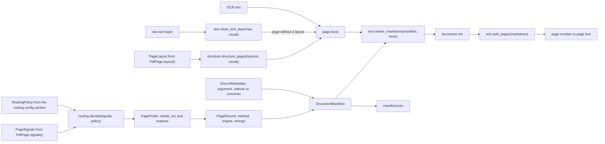
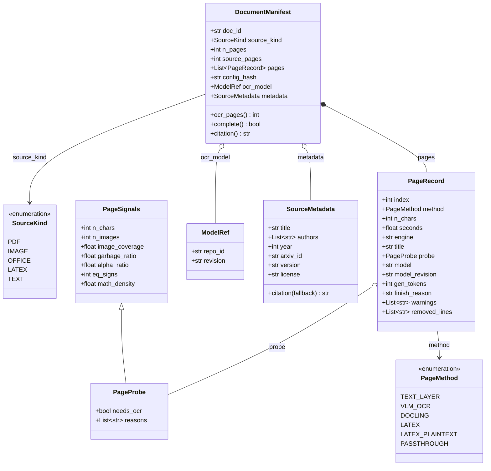
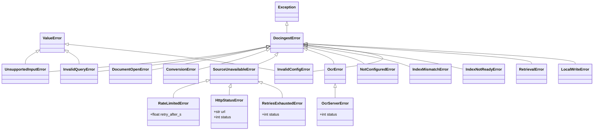

# `docingest.domain`

The domain layer holds the canonical representation of an ingested document, the OCR routing policy, the pure text functions, the page-aware chunker and the error hierarchy. It performs no I/O and knows no adapter. Every other layer depends on it; it depends only on the Python standard library and pydantic.

The import-linter contract "Domain is pure: no I/O or framework libraries" in `pyproject.toml` enforces this: `docingest.domain` may not import pypdfium2, PIL, numpy, mlx, mlx_vlm, paperqa, docling, pypandoc, huggingface_hub, httpx, urllib, typer, rich or jiwer.

Related reading: [package map](../README.md), [ports](../ports/README.md), [application](../application/README.md), [ADR 0002: per-page routing and content-addressed cache](../../../docs/adr/0002-per-page-routing-and-content-addressed-cache.md).

## Contents

- [Modules](#modules)
- [How domain objects flow through an ingestion](#how-domain-objects-flow-through-an-ingestion)
- [models.py](#modelspy)
- [routing.py](#routingpy)
- [text.py](#textpy)
- [Text-layer structure](#text-layer-structure-layoutpy-furniturepy-headingspy-structurepy)
- [chunking.py](#chunkingpy)
- [circuits.py](#circuitspy)
- [qasm.py](#qasmpy)
- [equations.py](#equationspy)
- [blocks.py](#blockspy)
- [errors.py](#errorspy)
- [Changing the domain safely](#changing-the-domain-safely)

## Modules

| Module | Contains | Used by |
|---|---|---|
| `models.py` | `SourceKind`, `PageMethod`, `PageSignals`, `PageProbe`, `ModelRef`, `AnswerModel`, `SourceMetadata`, `PageRecord`, `DocumentManifest` (pydantic models and `StrEnum`s) | every layer |
| `routing.py` | `RoutingPolicy` (thresholds, the `[routing]` config section), `decide()`, and the blank-page rule (`could_be_blank`, `is_blank`, `blank_probe`) | `IngestService` for every PDF page, `config.AppConfig.routing` |
| `ocr_guards.py` | `OcrGuards` (thresholds), `OutputProblem`, `find_problem`, `is_looping`, `retry_max_tokens`, `duplicate_pages` | the OCR adapters' retry ladder, `IngestService` |
| `text.py` | `HYPHEN_MARK`, `garbage_ratio`, `alpha_ratio`, `equals_count`, `math_density`, `is_math_char`, `text_vocabulary`, `clean_text_layer`, `collapse_dot_leaders`, `render_markdown`, `split_pages` | PDF adapter (signals), `IngestService` (clean-up, rendering), synthetic benchmark suite (clean reference text), PaperQA2 adapter and hook, `eval-ocr` command (splitting) |
| `layout.py` | `TextLine`, `PageLayout`, `StructuredPage` (what a PDF adapter reports about a page's lines) | `PdfPage.layout()`, `IngestService` |
| `furniture.py` | `repeated_lines`, `page_numbers` (running headers, running footers, page numbers) | `structure.py` |
| `headings.py` | `line_style`, `page_styles`, `level`, `is_marker`, `is_caption` | `structure.py` |
| `structure.py` | `structure_pages` (text-layer pages of a document to Markdown) | `IngestService` for the text-layer pages of a PDF |
| `chunking.py` | `Chunk`, `chunk_pages`, `CHUNKER_VERSION`, `CHUNK_CHARS`, `OVERLAP` | `ports` (`Chunk` is re-exported there); the chunk index and `AskService` use it through those |
| `circuits.py` | `gate_list`, `GateList`, `GateOp`, `CircuitSteps`, `circuit_code_blocks`, `CodeBlock`, `add_gate_lists`, `MAX_STEPS`, `MAX_GATE_WIRES`, `CIRCUIT_FORMAT` | `AskService` (the text of a gate list after each circuit code block of the retrieved chunks); `GateList.circuits` is for callers that must compute with a circuit (nothing in this package reads it yet) |
| `qasm.py` | `to_qasm`, `QasmProgram`, `QasmExport`, `QASM_VERSION` | `QasmExportService` (`application/qasm.py`), which `docingest circuits export` and the post-ingest `--qasm` hook drive |
| `equations.py` | `equation_references`, `canonical`, `find_equations`, `EquationSpan`, `chunk_for`, `covers`, `equation_header`, `content_words`, `title_overlap`, `lead_sentence_start`, `MAX_REFERENCES`, `MIN_TITLE_WORDS`, `LOOK_BACK`, `TITLE_LENGTH` | `AskService` (the chunk of an equation number the question names) |
| `blocks.py` | `find_blocks`, `attach_captions`, `whole_blocks`, `Block`, `Whole`, `complete`, `Completion`, `partial_note`, `BLOCK_MAX` | `AskService` (the rest of a display equation, code block or table that a retrieved chunk cuts) |
| `errors.py` | `DocingestError` and its subclasses | adapters raise them, application and entrypoints handle them |

## How domain objects flow through an ingestion

The diagram follows one PDF page and one document through the domain types and functions. Image frames and converter segments skip the routing part and go straight to `PageRecord`.



## models.py

`models.py` defines the canonical intermediate representation. Whatever the input, the pipeline emits the same two artifacts: `document.md` (normalized Markdown with page markers) and `manifest.json` (a serialized `DocumentManifest`). Downstream consumers only ever see these.



The diagram shows the main fields only. The tables below list every field; `X | None` fields default to `None` unless stated.

### `SourceKind`

A `StrEnum` naming the kind of input. The type detector decides it; the kind selects the handler and is part of the cache key.

| Member | Value | Typical inputs | Handled by |
|---|---|---|---|
| `PDF` | `"pdf"` | `.pdf` files (detected by the `%PDF-` header) | `PdfReader`, the routing policy and `OcrEngine`, page by page |
| `IMAGE` | `"image"` | PNG, JPEG, TIFF (multi-frame), GIF, WebP, BMP | `ImageSource`, then `OcrEngine` for every frame |
| `OFFICE` | `"office"` | `.docx`, `.pptx`, `.xlsx`, `.html`, `.htm`, `.xhtml` | the `office` converter |
| `LATEX` | `"latex"` | `.tex`, `.ltx`, tar archives, arXiv `.tar.gz` and single gzipped `.tex` | the `latex` converter |
| `TEXT` | `"text"` | `.md`, `.markdown`, `.txt` | the `text` converter |

The exact detection rules (magic bytes first, suffix as fallback) are described in [adapters/README.md](../adapters/README.md).

### `PageMethod`

A `StrEnum` naming how the text of one page or segment was produced. It is stored in `PageRecord.method` and written into the page marker of `document.md`.

| Member | Value | Produced by | Input kinds |
|---|---|---|---|
| `TEXT_LAYER` | `"text_layer"` | `IngestService`, when `decide()` finds the embedded text usable; the text is the structured text layer (see [Text-layer structure](#text-layer-structure-layoutpy-furniturepy-headingspy-structurepy)); a page whose OCR output was rejected and which falls back to its layer keeps the cleaned flat text | PDF |
| `BLANK` | `"blank"` | `IngestService`, for a page that would go to OCR for lack of text but has at most `blank_max_chars` characters and fewer than `blank_max_ink` inked pixels; the text is empty and OCR is not called | PDF |
| `VLM_OCR` | `"vlm_ocr"` | `IngestService` through `OcrEngine.transcribe()` (an empty page whose OCR output was rejected also has this method) | PDF pages that need OCR, every image frame |
| `DOCLING` | `"docling"` | `DoclingConverter` | OFFICE |
| `LATEX` | `"latex"` | `PandocLatexConverter`, when pandoc succeeds (one segment per section) | LATEX |
| `LATEX_PLAINTEXT` | `"latex_plaintext"` | `PandocLatexConverter`, when it falls back to pylatexenc plain text: for the whole paper, or for single sections (and a reference list) while the rest of the paper is `LATEX` | LATEX |
| `PASSTHROUGH` | `"passthrough"` | `PassthroughConverter` (file content as one segment) | TEXT |

### `PageSignals`

Raw measurements of one PDF page, produced by a `PdfReader` adapter (`PdfPage.signals()`). They are the only input of the routing policy.

| Field | Type | Default | Meaning |
|---|---|---|---|
| `n_chars` | `int` | `0` | Number of non-whitespace characters in the embedded text layer. |
| `n_images` | `int` | `0` | Number of image objects on the page. |
| `image_coverage` | `float` | `0.0` | Fraction of the page area covered by image objects (the union of their rectangles: overlaps count once), from 0 to 1. |
| `garbage_ratio` | `float` | `0.0` | Share of characters that indicate a broken text layer, computed with `text.garbage_ratio`. |
| `alpha_ratio` | `float` | `0.0` | Share of letters among non-space characters, computed with `text.alpha_ratio`. |
| `eq_signs` | `int` | `0` | Number of `=` in the text layer, computed with `text.equals_count`. Read by the math rule (6). A probe written before the signal existed loads with 0. |
| `math_density` | `float` | `0.0` | Share of math-symbol characters among the non-space characters of the text layer, computed with `text.math_density`. Read by the math rule (6). Like `eq_signs`, 0 in results cached before the signal existed. Greek letters and letterlike symbols (`™`) count as math symbols. |

### `PageProbe`

`PageProbe` extends `PageSignals` with the routing decision taken on them. It is created only by `routing.decide()` and is stored in `PageRecord.probe` for every PDF page, whichever way it was routed.

| Field | Type | Default | Meaning |
|---|---|---|---|
| (all `PageSignals` fields) | | | copied from the measured signals |
| `needs_ocr` | `bool` | `False` | `True` when at least one reason was recorded. |
| `reasons` | `list[str]` | `[]` | Human-readable reasons, one per rule that fired (see [routing.py](#routingpy)). |

### `ModelRef`

A pinned model: `repo_id: str` (for example a Hugging Face repository id) and `revision: str` (a commit of that repository). Both are required. `OcrEngine.model` is a `ModelRef`, and it is copied into `PageRecord.model` / `model_revision` and `DocumentManifest.ocr_model`. `config.OcrConfig` refuses a non-default `repo_id` without a `revision`, so the model that produced an OCR page is always identifiable.

### `AnswerModel`

The model that writes the answers of `ask`, frozen: `name: str` (the repository of the pinned model, else a litellm model string) and `revision: str | None` (a commit of `name`; `None` for a litellm model, which has no pin). It holds no address and no key. `Container.answer_model` builds it; see the [application README](../application/README.md#the-answer-model).

### `SourceMetadata`

Bibliographic metadata. Every field is optional.

| Field | Type | Default | Meaning |
|---|---|---|---|
| `title` | `str \| None` | `None` | Document title. When set, it becomes the manifest title. |
| `authors` | `list[str]` | `[]` | Author names, in order. |
| `year` | `int \| None` | `None` | Publication year. |
| `abstract` | `str \| None` | `None` | Abstract text. |
| `doi` | `str \| None` | `None` | DOI. |
| `arxiv_id` | `str \| None` | `None` | arXiv id without version, for example `"1706.03762"`. |
| `version` | `str \| None` | `None` | arXiv version, for example `"v7"`. |
| `url` | `str \| None` | `None` | Landing page URL. |
| `license` | `str \| None` | `None` | License URL or identifier. |
| `categories` | `list[str]` | `[]` | Subject categories, for example arXiv categories. |

Where it comes from: the `metadata` argument of `IngestService.ingest`, a `<file>.meta.json` sidecar next to the input (written by `CrawlService` for every crawled file), or the converter (the pandoc LaTeX converter extracts title, authors and abstract).

`citation(fallback: str) -> str` builds the short citation used in QA answers:

1. The last whitespace-separated word of the first author, followed by ` et al.` when there is more than one author.
2. `(year)` when `year` is set.
3. `title`, or `fallback` when there is no title.
4. `arXiv:<arxiv_id><version>` when `arxiv_id` is set.

The parts that exist are joined with `". "`:

| Metadata | `citation(...)` |
|---|---|
| authors `["Ashish Vaswani", "Noam Shazeer"]`, year 2017, title `"Attention Is All You Need"`, arxiv_id `"1706.03762"`, version `"v7"` | `Vaswani et al. (2017). Attention Is All You Need. arXiv:1706.03762v7` |
| authors `["Ada Lovelace"]`, no title, fallback `"notes.md"` | `Lovelace. notes.md` |
| nothing, fallback `"paper.pdf"` | `paper.pdf` |

### `PageRecord`

Provenance of one page (PDF), frame (image) or segment (converter).

| Field | Type | Default | Set for | Meaning |
|---|---|---|---|---|
| `index` | `int` | required | all | 0-based position. The page marker in `document.md` uses `index + 1`. |
| `method` | `PageMethod` | required | all | How the text was produced. |
| `n_chars` | `int` | required | all | Length of the page text as written to `document.md`. For text-layer pages this is measured after clean-up. |
| `seconds` | `float` | required | all | Time spent on this page. For text-layer pages, the time to read the page's signals (rounded to 3 decimals; clean-up runs later for the whole document). For OCR pages, `OcrResult.seconds` rounded to 2 decimals. For converter segments, the conversion time divided equally over the kept segments. |
| `engine` | `str \| None` | `None` | all | What produced the text: `PdfReader.fingerprint` for text-layer pages (for example `"pypdfium2 5.13.0 signals 2"`; the second part is the version of the reader's measurements), `OcrEngine.fingerprint` for OCR pages, `Conversion.engine` for segments (for example `"pandoc 3.8"`). |
| `title` | `str \| None` | `None` | converter segments | Section or segment title (`Segment.title`). |
| `probe` | `PageProbe \| None` | `None` | PDF pages | Signals and routing decision. `None` for image frames and converter segments. |
| `model` | `str \| None` | `None` | OCR pages | `OcrEngine.model.repo_id`. |
| `model_revision` | `str \| None` | `None` | OCR pages | `OcrEngine.model.revision`. |
| `gen_tokens` | `int \| None` | `None` | OCR pages | Tokens generated for the attempt whose text was kept. |
| `finish_reason` | `str \| None` | `None` | OCR pages | Why generation stopped, for example `"stop"` or `"length"` (a truncation). |
| `warnings` | `list[str]` | `[]` | OCR pages | What the pipeline did about the page beyond the plain route: the OCR output was rejected (`OCR output rejected (<why>); the text layer was used` or `...; the page was left empty`) or cut off at the token limit. Empty for an ordinary page; manifests written before the field existed load with `[]`. |
| `removed_lines` | `list[str]` | `[]` | text-layer pages | The running headers, running footers and page numbers taken out of the page text, in page order, white space normalized. Empty when nothing was removed or the reader gave no layout. |

### `DocumentManifest`

The provenance record of one ingestion run, serialized as `manifest.json`.

| Field | Type | Default | Meaning |
|---|---|---|---|
| `doc_id` | `str` | required | SHA-256 of the raw input bytes, 64 lowercase hex characters (content-addressed). |
| `source_path` | `str` | required | Absolute path of the input at ingestion time. |
| `source_name` | `str` | required | File name of the input. |
| `source_kind` | `SourceKind` | required | Detected kind. |
| `mime` | `str` | required | MIME type returned by the detector. |
| `size_bytes` | `int` | required | Input size in bytes. |
| `n_pages` | `int` | required | Pages, frames or segments processed in this run. |
| `source_pages` | `int` | required | Pages, frames or segments in the source. |
| `max_pages` | `int \| None` | `None` | The `max_pages` run option, recorded for provenance. |
| `ocr_all` | `bool` | `False` | The `ocr_all` run option. Only ever `True` for PDFs. |
| `pages` | `list[PageRecord]` | required | One record per processed page, in order. |
| `pipeline_version` | `str` | required | `application.ingest.PIPELINE_VERSION` at ingestion time. |
| `config_hash` | `str` | required | Cache key of this run (see the invariants below). |
| `ocr_model` | `ModelRef \| None` | `None` | The OCR engine's model, set only when at least one page used OCR. |
| `title` | `str \| None` | `None` | Document title. |
| `metadata` | `SourceMetadata \| None` | `None` | Bibliographic metadata, when known. |
| `created_at` | `str` | now | UTC timestamp in ISO 8601 with seconds precision, set when the manifest is created. |
| `total_seconds` | `float` | `0.0` | Processing wall time, rounded to 2 decimals. |

Derived members:

| Member | Returns |
|---|---|
| `ocr_pages` (property) | Number of pages whose `method` is `VLM_OCR`. |
| `complete` (property) | `n_pages == source_pages`. `False` means a partial run (`max_pages` below the source length). |
| `citation()` | `metadata.citation(title or source_name)` when metadata exists, else `"<title> (<source_name>)"` when there is a title, else `source_name`. |

#### Invariants

`IngestService` maintains these when it builds a manifest, and stores rely on them:

1. `doc_id` depends only on the bytes. The same file under another name or path has the same `doc_id`. The filesystem store names directories after `doc_id[:16]`.
2. `len(pages) == n_pages` and `pages[i].index == i`.
3. `n_pages <= source_pages`. A result is complete exactly when they are equal.
4. `config_hash` is the first 12 hex characters of the SHA-256 of a JSON list `[PIPELINE_VERSION, source_kind value, ocr_all, *parts]`, where `parts` depends on the kind:
   - PDF: the routing policy as JSON, the OCR output-check thresholds (`OcrGuards`) as JSON, `PdfReader.fingerprint`, `OcrEngine.fingerprint`;
   - IMAGE: the `OcrGuards` JSON, `ImageSource.fingerprint`, `OcrEngine.fingerprint`;
   - OFFICE, LATEX, TEXT: the fingerprint of that kind's converter.

   It is computed by `IngestService.config_hash()`; the domain only stores it.
5. `ocr_model` is set if and only if some page has `method == VLM_OCR`. A page whose OCR output was rejected and replaced by its text layer has `method == TEXT_LAYER`, and `PageRecord.warnings` says why.
6. `title` is always set by `IngestService`: `metadata.title`, else the document's own title (PDF `Title` info or the converter's title), else the file name without its last suffix (`Path.stem`).
7. A store treats a result as canonical only when it is complete and `ocr_all` is `False` (and it was not produced by a degraded fallback). Everything else is a variant that never replaces a canonical result.
8. After creation a manifest changes only in one way: when a cached result is served with new metadata, `IngestService` replaces `metadata` and `title` (with `model_copy`) and saves it again in place.

#### Example `manifest.json`

A two-page PDF whose first page has a usable text layer and whose second page is a scan. Values are illustrative; the OCR `engine` string is the full engine fingerprint and is shortened here.

```json
{
  "doc_id": "9f2c000000000000000000000000000000000000000000000000000000000000",
  "source_path": "/abs/path/paper.pdf",
  "source_name": "paper.pdf",
  "source_kind": "pdf",
  "mime": "application/pdf",
  "size_bytes": 482113,
  "n_pages": 2,
  "source_pages": 2,
  "max_pages": null,
  "ocr_all": false,
  "pages": [
    {
      "index": 0,
      "method": "text_layer",
      "n_chars": 2688,
      "seconds": 0.012,
      "engine": "pypdfium2 5.13.0 signals 2",
      "title": null,
      "probe": {
        "n_chars": 2710,
        "n_images": 0,
        "image_coverage": 0.0,
        "garbage_ratio": 0.0,
        "alpha_ratio": 0.83,
        "eq_signs": 3,
        "math_density": 0.0021,
        "needs_ocr": false,
        "reasons": []
      },
      "model": null,
      "model_revision": null,
      "gen_tokens": null,
      "finish_reason": null,
      "removed_lines": ["Signal Sampling 7", "7"]
    },
    {
      "index": 1,
      "method": "vlm_ocr",
      "n_chars": 1934,
      "seconds": 41.3,
      "engine": "mlx-vlm {...}",
      "title": null,
      "probe": {
        "n_chars": 0,
        "n_images": 1,
        "image_coverage": 1.0,
        "garbage_ratio": 0.0,
        "alpha_ratio": 0.0,
        "eq_signs": 0,
        "math_density": 0.0,
        "needs_ocr": true,
        "reasons": [
          "only 0 embedded chars (<50)",
          "image covers 100% of page with little text"
        ]
      },
      "model": "mlx-community/Qwen3-VL-4B-Instruct-4bit",
      "model_revision": "2fd8dacbdb8f1e54b8c005f081ec5bf79c56376b",
      "gen_tokens": 602,
      "finish_reason": "stop",
      "removed_lines": []
    }
  ],
  "pipeline_version": "0.4.1",
  "config_hash": "1a2b3c4d5e6f",
  "ocr_model": {
    "repo_id": "mlx-community/Qwen3-VL-4B-Instruct-4bit",
    "revision": "2fd8dacbdb8f1e54b8c005f081ec5bf79c56376b"
  },
  "title": "paper",
  "metadata": null,
  "created_at": "2026-09-25T19:57:51+00:00",
  "total_seconds": 41.4
}
```

Note that `probe.n_chars` counts non-whitespace characters of the raw text layer, while the record's `n_chars` is the length of the structured page text (after the running lines were taken out and the lines joined).

## routing.py

`routing.py` decides, for each PDF page, whether the embedded text layer can be used or the page must be rendered and sent to OCR. The decision is a pure function of the measured `PageSignals` and a `RoutingPolicy`.

### `RoutingPolicy`

A pydantic model; its values come from the `[routing]` section of `config/pipeline.toml` (`AppConfig.routing`). The defaults follow published pipelines (Marker, olmOCR).

| Field | Type | Default | Meaning |
|---|---|---|---|
| `min_chars` | `int` | `50` | A page with fewer embedded non-whitespace characters is treated as scanned. |
| `image_coverage` | `float` | `0.6` | Image-coverage threshold for the "large image with little text" rule. |
| `image_coverage_max_chars` | `int` | `400` | "Little text" for that rule: fewer characters than this. |
| `max_garbage_ratio` | `float` | `0.10` | Above this share of broken glyphs the text layer is considered garbled. |
| `min_alpha_ratio` | `float` | `0.5` | Below this share of letters the text layer is considered suspicious (olmOCR heuristic). |
| `blank_max_chars` | `int` | `10` | A page that would go to OCR is blank only if it has at most this many characters. |
| `blank_max_ink` | `float` | `0.0005` | ...and fewer than this share of its pixels are ink. `0` turns the blank rule off. |
| `blank_ink_contrast` | `int` | `32` | Grey levels under the page background that make a pixel ink, after a 3x3 median filter (`application/ink.py` does the measuring; the domain holds only the thresholds). |
| `blank_dark_page` | `int` | `128` | A page with a median grey below this counts as all ink. |
| `scan_layer_to_ocr` | `bool` | `True` | A page that is a scan (images cover at least `scan_image_cover`) and has at least `min_chars` characters of text layer needs OCR. `False` keeps the layer. |
| `scan_image_cover` | `float` | `0.8` | Image coverage from which a page counts as a scan for that rule; above 0, at most 1. |
| `math_to_ocr` | `bool` | `False` | A page with at least `min_chars` characters of text layer and at least `math_min_equals` equals signs, or a `math_density` of at least `math_min_density`, needs OCR. Off by default. |
| `math_min_equals` | `int` | `5` | Equals signs from which a page is math-heavy; 1 or more. |
| `math_min_density` | `float` | `0.04` | Math-symbol share from which a page is math-heavy; above 0, at most 1. |

`RoutingPolicy` forbids unknown fields (`extra="forbid"`), like the other config sections: a misspelled key in `[routing]` is a validation error, never a silently ignored threshold.

### Blank pages: `could_be_blank`, `is_blank`, `blank_probe`

`could_be_blank(signals, policy)` says whether the text alone allows the rule (`blank_max_ink > 0` and `n_chars <= blank_max_chars`), so the caller measures the ink only for those pages. `is_blank(signals, ink, policy)` adds `ink < blank_max_ink`, where `ink` is the share of inked pixels measured by `application/ink.py`. `blank_probe(probe, ink, policy)` is the probe stored for a blank page: `needs_ocr` false, one reason holding the measurements. The domain stays free of image libraries; the measuring is in the application layer.

### `decide(signals, policy, *, force_ocr=False) -> PageProbe`

Every rule is evaluated; each one that fires adds a reason. `needs_ocr` is `True` when there is at least one reason.

| # | Rule fires when | Reason recorded |
|---|---|---|
| 1 | `n_chars < min_chars` | `only <n_chars> embedded chars (<<min_chars>)` |
| 2 | `image_coverage >= policy.image_coverage` and `n_chars < image_coverage_max_chars` | `image covers <coverage as %> of page with little text` |
| 3 | `garbage_ratio > max_garbage_ratio` | `garbled text layer (<garbage_ratio as %> bad glyphs)` |
| 4 | `n_chars >= min_chars` and `alpha_ratio < min_alpha_ratio` | `low alphabetic ratio (<alpha_ratio as %>)` |
| 5 | `scan_layer_to_ocr` and `n_chars >= min_chars` and `image_coverage >= scan_image_cover` | `scanned page with a text layer: images cover <coverage as %> of the page, <n_chars> embedded chars` |
| 6 | `math_to_ocr` and `n_chars >= min_chars` and (`eq_signs >= math_min_equals` or `math_density >= math_min_density`) | `math-heavy page with a text layer: <eq_signs> '=' signs, math symbols <math_density as %> of the characters` |
| 7 | `force_ocr` is `True` and no other rule fired | `forced (--ocr-all)` |

The diagram shows the order in which `decide` evaluates the rules for one page. No rule short-circuits the others: each one that fires appends its reason, and the forced reason is added only when the list is still empty.

```mermaid
flowchart TD
    S["PageSignals and RoutingPolicy"] --> R1{"n_chars below min_chars?"}
    R1 -->|yes| A1["add: only N embedded chars"]
    R1 -->|no| R2{"image_coverage at least threshold and n_chars below image_coverage_max_chars?"}
    A1 --> R2
    R2 -->|yes| A2["add: image covers the page with little text"]
    R2 -->|no| R3{"garbage_ratio above max_garbage_ratio?"}
    A2 --> R3
    R3 -->|yes| A3["add: garbled text layer"]
    R3 -->|no| R4{"n_chars at least min_chars and alpha_ratio below min_alpha_ratio?"}
    A3 --> R4
    R4 -->|yes| A4["add: low alphabetic ratio"]
    R4 -->|no| R5{"scan_layer_to_ocr, n_chars at least min_chars and image_coverage at least scan_image_cover?"}
    A4 --> R5
    R5 -->|yes| A5["add: scanned page with a text layer"]
    R5 -->|no| R6{"math_to_ocr, n_chars at least min_chars and eq_signs or math_density at least its threshold?"}
    A5 --> R6
    R6 -->|yes| A6["add: math-heavy page with a text layer"]
    R6 -->|no| F{"force_ocr and no reasons yet?"}
    A6 --> F
    F -->|yes| A7["add the forced reason"]
    F -->|no| OUT["PageProbe: needs_ocr is true when reasons is not empty"]
    A7 --> OUT
```



Properties to rely on:

- Reasons accumulate: a blank scanned page typically records both rule 1 and rule 2.
- Rule 4 applies only when rule 1 does not, so a nearly empty page is never also flagged for its letter ratio. Rule 5 likewise leaves pages under `min_chars` to rule 1.
- Rule 5 is the only one that sends a page to OCR for having a long, clean text layer. A scan whose layer is shorter than `image_coverage_max_chars` records rule 2 as well, and keeps going to OCR with `scan_layer_to_ocr = False`.
- Rule 6 is off by default and, like rules 4 and 5, leaves pages under `min_chars` to rule 1. A page that rule 4 flagged for its letter ratio and that is also math-heavy records both reasons.
- With `force_ocr=True` the page always needs OCR. The `forced (--ocr-all)` reason is added only when no rule fired, so a page that would have gone to OCR anyway keeps its real reasons.
- `decide` is deterministic and has no side effects. It returns a new `PageProbe` with the signals copied in.
- The policy is part of the cache key of PDF inputs only (`RoutingPolicy.cache_json()` is in `config_hash`). `cache_json()` leaves `math_to_ocr`, `math_min_equals` and `math_min_density` out while `math_to_ocr` is `False`, so a policy that does not use the rule hashes as it did before the rule existed. Changing a threshold re-processes PDFs on the next run and leaves images and converter inputs cached.

Examples (the cases in `tests/unit/test_routing_policy.py` and `tests/unit/test_math_routing.py`, run with the default policy unless stated):

| Signals | `needs_ocr` | `reasons` |
|---|---|---|
| `n_chars=3000, alpha_ratio=0.8` | `False` | none |
| `n_chars=0, n_images=1, image_coverage=1.0` | `True` | `only 0 embedded chars (<50)`, `image covers 100% of page with little text` |
| `n_chars=120, image_coverage=0.9, alpha_ratio=0.8` | `True` | `image covers 90% of page with little text`, `scanned page with a text layer: images cover 90% of the page, 120 embedded chars` |
| `n_chars=2000, image_coverage=0.9, alpha_ratio=0.8` | `True` | `scanned page with a text layer: images cover 90% of the page, 2000 embedded chars` |
| `n_chars=2000, image_coverage=0.5, alpha_ratio=0.8` | `False` | none (a figure on a page of text) |
| `n_chars=2000, alpha_ratio=0.9, eq_signs=12, math_density=0.05`, with `math_to_ocr=True` | `True` | `math-heavy page with a text layer: 12 '=' signs, math symbols 5.0% of the characters` (the same page with the default policy: `False`, none) |
| `n_chars=900, garbage_ratio=0.4, alpha_ratio=0.8` | `True` | `garbled text layer (40% bad glyphs)` |
| `n_chars=900, alpha_ratio=0.2` | `True` | `low alphabetic ratio (20%)` |

```python
from docingest.domain.models import PageSignals
from docingest.domain.routing import RoutingPolicy, decide

probe = decide(PageSignals(n_chars=900, alpha_ratio=0.2), RoutingPolicy())
print(probe.needs_ocr, probe.reasons)  # True ['low alphabetic ratio (20%)']

lenient = RoutingPolicy(min_chars=0, min_alpha_ratio=0)
print(decide(PageSignals(n_chars=0), lenient).needs_ocr)  # False
```

## text.py

Pure string functions: quality signals for a PDF text layer, its clean-up, and the Markdown format of `document.md`.

| Name | Signature | Purpose |
|---|---|---|
| `HYPHEN_MARK` | `"\x02"` | The character pdfium puts in place of a line-end hyphen when it joins the two lines. |
| `garbage_ratio` | `(text: str) -> float` | Share of characters that indicate a broken text layer. |
| `alpha_ratio` | `(text: str) -> float` | Share of letters among non-space characters. |
| `equals_count` | `(text: str) -> int` | Number of `=` signs. |
| `math_density` | `(text: str) -> float` | Share of math-symbol characters among non-space characters (without `HYPHEN_MARK`). |
| `is_math_char` | `(c: str) -> bool` | Whether a character is a math symbol: Greek, arrows, mathematical operators, technical brackets, angle brackets, supplemental operators, letterlike symbols, mathematical alphanumerics, and `± × ÷ √ ∞ ∑ ∏ ∫ ≈ ≠ ≤ ≥ ⊗ ⊕ † ˆ`. ASCII operators are not. |
| `text_vocabulary` | `(*texts: str) -> set[str]` | Lower-cased word set used to decide de-hyphenation. |
| `clean_text_layer` | `(text: str, vocab: set[str] \| None = None) -> str` | Normalize a PDF text layer. |
| `collapse_dot_leaders` | `(text: str) -> str` | Remove the dot leaders between an entry and its page number on contents lines. |
| `render_markdown` | `(manifest: DocumentManifest, texts: list[str]) -> str` | Build `document.md` from a manifest and its page texts. |
| `split_pages` | `(markdown: str) -> dict[int, str]` | Inverse of `render_markdown`: page number to page text. |

### Quality signals

- `garbage_ratio(text)`: whitespace is removed first. The "bad" count is the number of U+FFFD replacement characters, plus control characters below U+0020 other than `HYPHEN_MARK`, plus private-use characters (U+E000 to U+F8FF), plus the total length of every `(cid:N)` sequence (unmapped glyphs). The result is bad / non-whitespace length, or `0.0` for empty text.
- `alpha_ratio(text)`: characters for which `str.isalpha()` is true, divided by the non-whitespace length, or `0.0` for empty text. olmOCR flags text below 0.5 as a bad text layer.

- `equals_count(text)` and `math_density(text)`: the two signals of the math rule. The density is the count of `is_math_char` characters over the non-whitespace length after the soft-hyphen mark is removed, or `0.0` for empty text.

A new `PdfReader` adapter should compute `PageSignals.garbage_ratio`, `alpha_ratio`, `eq_signs` and `math_density` with these functions so that the routing thresholds keep their meaning.

### `clean_text_layer(text, vocab=None)`

Applied to the text of every text-layer page whose reader gave no layout, and as the last step of `structure_pages` for the ones that did. In this order:

1. Line endings `\r\n` and `\r` become `\n`.
2. If `vocab` is `None`, the vocabulary of `text` itself is used.
3. Every `word<HYPHEN_MARK>word` is joined into one word when the joined word (lower-cased) is in the vocabulary, otherwise it becomes `word-word`. Keeping the hyphen never loses information.
4. Any remaining `HYPHEN_MARK` becomes `-`.
5. A `-` followed by a line break between two word characters is kept and the line break is removed: identifiers and number ranges such as `2019-2020` or `Qwen-2.5-VL-7B` stay intact.
6. Control characters U+0000 to U+0008, U+000B, U+000C and U+000E to U+001F are removed (tab and newline are kept).
7. Spaces and tabs at the end of a line are removed.
8. Three or more consecutive newlines become two.
9. Leading and trailing whitespace is stripped.

`IngestService` builds the vocabulary once per document, from the raw text of every text-layer page plus the OCR text of every OCR page, before cleaning any page. A word hyphenated on page 3 is therefore joined if it appears unbroken anywhere in the document.

| Input | Vocabulary contains | Output |
|---|---|---|
| `transduc\x02tion` | `transduction` | `transduction` |
| `transduc\x02tion` | (empty set) | `transduc-tion` |
| `sequence\x02aligned` | no `sequencealigned` | `sequence-aligned` |
| `2019-\r\n2020` | any | `2019-2020` |

### `collapse_dot_leaders(text)`

`Title . . . . . 23` becomes `Title 23`. Applied by `IngestService` to the text of every PDF and image page after reading, so a contents page is the same whether the model wrote the leaders or not. Line by line, only the last run of dots on a line is looked at. A run is dots, middle dots (`·`, `∙`, `⋅`) and ellipsis characters (`…`, counted as three dots), with any number of spaces, tabs or other blanks between them (`.....  .....` and `.  .  .  .` are one run). The line changes when:

- the run has at least 4 dots and what follows it, after surrounding spaces, is a page number: digits (1 to 4), a well formed Roman numeral below 400 in lower or upper case (`iii`, `xiv`, `CCCXCIX`; a word that happens to be made of those letters, such as `mild`, `civil`, `mix` or `did`, is not one), a letter, a hyphen and digits (`A-12`) or two numbers joined by a hyphen (`3-14`); the result is the text before the run, a space and the page number (or only the number when nothing comes before the run);
- or the run has at least 6 dots, text comes before it and nothing follows it: the run is removed.

Anything else is returned as it was: `...` and `. . .` (ellipses of prose), `trailed off....` (an ellipsis and a full stop), `1.2.3` (a section number: the dots are not a run), a run followed by words, a run in the middle of a sentence, a line of only dots. The function is idempotent (one pass is enough, whatever the blanks between the dots) and returns its argument when the text has no dot character.

| Input | Output |
|---|---|
| `Title . . . . . 23` | `Title 23` |
| `1.2.3 Heaps ........ 17` | `1.2.3 Heaps 17` |
| `Preface ...... xiv` | `Preface xiv` |
| `Wait... what?` | unchanged |
| `Title ... 23` | unchanged |
| `Wait .... did` | unchanged (`did` is not a page number) |

### Markdown format: `render_markdown` and `split_pages`

`render_markdown(manifest, texts)` writes an optional title line and then one block per page record:

```text
# <manifest.title>

<!-- page 1 | method=text_layer -->
<text of page 1>

<!-- page 2 | method=vlm_ocr -->
<text of page 2>
```

- The `# title` line is written only when `manifest.title` is set. A blank line follows it.
- Page numbers are `PageRecord.index + 1`; `method` is the `PageMethod` value.
- `texts` must have exactly one entry per `manifest.pages` element, otherwise `ValueError` (the pairing uses `zip(..., strict=True)`).
- The output has no leading whitespace and ends with exactly one newline.
- Page text is written as is, without escaping.

`split_pages(markdown)` finds lines that consist exactly of `<!-- page <N> | method=<word> -->` and returns `{N: text}`, with each page's text stripped. Anything before the first marker (the title) is dropped. Marker-like text inside a line is not a marker, but a page whose text contains a whole line in exactly that format would be split there.

```python
from docingest.domain.text import split_pages

md = (
    "# T\n\n<!-- page 1 | method=text_layer -->\nhello <!-- page 9 --> world\n\n"
    "<!-- page 2 | method=vlm_ocr -->\nsecond\n"
)
print(split_pages(md))  # {1: 'hello <!-- page 9 --> world', 2: 'second'}
```

`split_pages` is used by the PaperQA2 adapter and hook (to give PaperQA2 page-aware text, so citations point at page ranges) and by the `eval-ocr` command.

## Text-layer structure: `layout.py`, `furniture.py`, `headings.py`, `structure.py`

The text layer of a PDF is a stream of characters; the structure of the page is in how those characters are set. A `PdfReader` adapter reports each text-layer page as a `PageLayout`: its lines in reading order, each a `TextLine` with the text, the dominant font size in points, whether the line is bold, its horizontal extent, its baseline (points from the top of the page) and whether it is upright (rotated margin stamps and vertical labels are not). `structure.structure_pages(layouts, vocab)` looks at all the pages of a document at once and returns, for each page that has lines, a `StructuredPage(text, removed)`. It changes only text-layer pages of PDFs; OCR pages, images, LaTeX, office and text inputs do not go through it. A page with no lines is left out of the result and the caller uses `clean_text_layer` on its flat text, as before.

Every rule is conservative. When it is not sure, the text stays as the text layer wrote it: a line break instead of a joined paragraph, plain text instead of a heading, a line kept instead of removed.

**Running headers, footers and page numbers** (`furniture.py`). Only the margin lines of a page are candidates: the rows between the page edge and the first vertical gap wider than 1.4 line pitches inside the top or bottom 15% of the page (the outermost row only when there is no such gap), so the first and last body lines of a page, where `where`, `Proof.` or `and` can recur, are not. They are compared across the document after lower-casing and replacing every run of digits with `#`, so `64 3. Signal Sampling` and `65 3. Signal Sampling` are the same line. Lines that are at least 85% similar (OCR noise) are the same line. A line that comes back on at least 3 pages is a running line, and in documents of more than 5 pages it must also be on at least 30% of the pages between its first and its last occurrence (a head is on every page or every other page; `Chapter 3` on a chapter opener every 10 pages is not). In documents of up to 5 pages two pages are enough. Of the lines in such a group, only those in the group's usual type size and on its usual row are removed, so a title set larger than the running header that repeats it stays. In documents of more than 5 pages, the first or last row of a page (at least 4 pages, and at least 30% of all pages) also counts as a running header when its first or last word (5 letters or more, not `Figure`, `Table`, ...) at the same size and row starts or ends the outermost line of at least 30% of the pages: that is how `Section 4.1 Lattices 23` and `18 Sampling Basics Chapter 1` are found although the title changes every few pages. A bare page number (`12`, `iv`, `Page 7 of 40`, `- 12 -`, `[ 58 ]`) is removed when it is the only number on a margin row and the rest of that row, if any, is a running line. A Roman numeral (`x`, `i`) also needs the gap that sets the margin off from the body, because a lone `x` is as likely a formula fragment. A document read with `max_pages` of 1 has nothing to compare: only bare page numbers go.

**Paragraphs** (`structure.py`). Per page, the columns (peaks of the left edges), the right edge of each column and the line pitch are measured. Between two consecutive lines the separator is:

| Separator | When |
|---|---|
| a space (same paragraph) | next line, same type size, both lines mostly letters, the first line reaches the right edge of its column, no list marker, no new indent |
| a line break (same block) | the lines are on the same row or a sub/superscript apart, or one of them is mostly digits and symbols (table rows, formulas), or the first line is short (a title, an address) |
| a blank line (new block) | a gap wider than 1.4 line pitches, a jump up to the next column, another type size, a list marker or reference entry (`•`, `1.`, `(a)`, `[3]`) at the start, a sentence that ends on a short line, or an indent that the previous line does not have (a hanging list indent does not count) |

A footnote (a block in type of 90% of the body size or smaller in the lower 30% of the page, starting with `*`, `†`, a number or a similar mark, and not a caption) that the stream puts before body text is moved behind it. Hyphenation is resolved when the lines are joined: a line that ends with the marker `HYPHEN_MARK` or with a real hyphen after a letter, followed by a lowercase letter, becomes `word<HYPHEN_MARK>word` and `clean_text_layer` decides with the document vocabulary (see above). A hyphen between digits or before a capital (`2019-` and `2020`, `Qwen-2.5-` and `VL`) is kept.

**Headings** (`headings.py`). The body size is the type size most characters of the document are set in (half-point steps). A line is a heading when it is at least 1.2 times the body size, or at least 1.05 times and bold. A line of about the body size (0.85 and up) needs more: if bold, a section number (`2`, `2.1`, `II.`, `A.`) or a standard section title (`Abstract`, `Conclusion`, ...); if regular, a hierarchical or Roman section number, a single number followed by a title in capitals-first words (`8. Conclusions`), a standard title, or capital letters only, and no sentence end. Lines with `=`, formulas, captions, author lines (`Firstname X. Lastname`), a running head with its page number on the outermost row (`64 3. Title`, `Title 65`; only when the line is not bold and not larger than 1.1 times the body, so a real section heading at the top of a page keeps its mark), body-size lines of more than 12 words, table-of-contents entries (dot leaders, a trailing page number), list items, and lines without a word of four letters are never headings. A style that makes up more than 40% of a page, or a run of more than 3 adjacent lines in one style, is a paragraph, not a list of headings. Consecutive lines of one heading style (up to 3) are one heading. Level: `#` for 1.5 times the body size or more, otherwise `##` for a section and one more `#` per level of its number (`2.1` is `###`, `2.1.3` is `####`); capped at `####`.

The thresholds are module constants (`ZONE`, `SIMILAR`, `MIN_PAGES`, `BIG`, `BOLD`, ... and the ones at the top of `structure.py`); there is no configuration for them. A change to any rule changes the output of text-layer pages, so it needs a `PIPELINE_VERSION` bump.

## chunking.py

`chunk_pages` cuts a document into the chunks that `docingest ask` gives to PaperQA2: the same text and the same names as PaperQA2's `chunk_pdf` on the pages of `document.md` (the one difference: for a document without pages `chunk_pdf` raises, `chunk_pages` returns no chunks). It is a pure function so that code that may not import `paperqa` (the application layer, a chunk index) cuts papers exactly like `ask` does. A test (`tests/integration/test_chunking_parity.py`) compares the two on documents and on random pages.

| Name | Meaning |
|---|---|
| `Chunk` | Frozen dataclass: `doc_id`, `name` (`"<doc_id[:16]> pages a-b"`, as cited), `text`, `first_page`, `last_page`, `is_reference` (default `False`; the caller sets it from the section titles, the chunker does not know them) and `start`, the offset of `text` in the page texts joined by `"\n\n"` (`"".join(t + "\n\n" for t in pages.values())`; the chunk ends at `start + len(text)`). `name` is not unique inside a paper (several chunks can be `pages 4-4`); `(doc_id, start)` is. |
| `chunk_pages(doc_id, pages, *, chunk_chars, overlap)` | `pages` is the `{page number: text}` of `split_pages`. Every page text is followed by `"\n\n"` so words do not fuse across pages, a chunk is cut every `chunk_chars` characters and the next one starts `overlap` characters earlier. A chunk names the first and last page it touches, always as a range (`pages 3-3` for one page). No pages give no chunks; `overlap` must be smaller than `chunk_chars`. Both settings are required: the callers pass `[qa] chunk_chars` and `overlap`, whose defaults are `CHUNK_CHARS` (900) and `OVERLAP` (100) from this module, so the number lives in one place. |
| `CHUNKER_VERSION` | Bump it when the algorithm changes, so an index built with the old one is not reused. |

```python
from docingest.domain.chunking import chunk_pages

chunks = chunk_pages("ab" * 32, {1: "x" * 500, 2: "y" * 500}, chunk_chars=900, overlap=100)
print([(c.name, c.start, len(c.text)) for c in chunks])
# [('abababababababab pages 1-2', 0, 900), ('abababababababab pages 2-2', 800, 204)]
```

## circuits.py

`circuits.py` writes a plain-text gate list from the LaTeX source of a quantum circuit, as a pure function (standard library only). The LaTeX converter keeps each circuit as a fenced `latex` code block with the author's code; `AskService` uses this module at answer time to add a list after the block (the block, the stored Markdown and the index are never changed). Why it exists and what it fixed: an answer model misreads the wire-and-column grid (two control dots joined by a wire read as a CNOT); the list says `controlled-Z on wires 1 and 2 (control dots on both, symmetric: no target)`.

| Name | Meaning |
|---|---|
| `gate_list(source)` | The list of the circuits in `source`, the body of one code block, as a `GateList`: `status` (`"parsed"` all circuits fully read, `"partial"` some part written as `unparsed`, `"unparsed"` nothing readable), `text` (empty when nothing could be read), `n_circuits` and `circuits` (the same reading as data, see [The steps as data](#the-steps-as-data)). Reads `quantikz`, `\Qcircuit`, `yquant` and `tikzcd` drawn as a circuit. |
| `circuit_code_blocks(markdown)` | The fenced `latex` blocks of a Markdown text as `CodeBlock(start, end, source)` (`text[start:end]` is both fences and the source). Other fenced blocks are skipped whole and a block that never closes is left out. One pass over the lines. |
| `add_gate_lists(text, start, document, blocks)` | `text` (a chunk found at `start` of `document`) with `gate_list` of every block whose closing fence lies inside the chunk, as a paragraph right after that fence (`"\n\n" + list + "\n"`). A block that began in the chunk before is read whole from `document`; a block cut by the end of the chunk gets nothing, and a block whose closing fence ends exactly where the chunk starts belongs to the chunk before; a chunk that is not where `start` says is returned as it is. `document` is the page texts joined as `chunk_pages` joins them. |
| `MAX_STEPS` | 60: a longer circuit is listed up to there, then `... N more lines not listed`. The data in `GateList.circuits` is not cut. |
| `GateOp`, `CircuitSteps` | The steps as data: frozen dataclasses, in memory only (see below). |
| `MAX_GATE_WIRES`, `CIRCUIT_FORMAT` | 128: a gate over more wires is `unparsed_op` as data (its text line is unchanged); `"circuit/1"`: the `format` of `CircuitSteps.to_dict()`. |

```text
Gate list (from the circuit code above; wires numbered top to bottom; one step per drawn column, left to right):
Wires: 1 = \ket{a}; 2 = \ket{b}
Step 1: H on wire 1
Step 2: CNOT: control wire 1, target wire 2
Step 3: measure wire 2
```

Rules of the reader:

- **Drawing order.** Grid columns (`&`) are the steps and rows (`\\`) the wires. A column with only wires is skipped, a row that draws nothing is not numbered (a quantikz row with as many cells as the widest row is a wire even when empty, as its manual draws with `&&&&& \\ &&&&&`; a Qcircuit row is a wire when a cell draws one, `\qw`, `\cw`, a bundle, a gate or `\ghost`, or holds an `\lstick`, and a row of text only, of barriers or of nothing is not), a row of dots is listed once. Text or a sign on a row that is not a wire is not left out: it is `unparsed on no wire: <text>` at its step (a caption such as `repeat $n$ times`, `\times n` or `(gates omitted)` can say that gates are left out), and an output label, a bundle or a legend on a row that is not listed (a row that draws no wire, or a row of dots with a label that is not dots) is unparsed too. It is not a schedule: gates in different columns may commute. A `\gate[n]`, `\lstick[wires=n]` or `\rstick[n]` that reaches past the last row gives its wires to those empty rows; a spacer row between two drawn rows is not a wire. An `\lstick` is the legend of its wire only when it is the first one of its row, stands alone in its cell and nothing is drawn before it on the row: no earlier gate, wire (`\qw`, `\cw`) or bundle, and no multi-wire box (`\gate[2]{...}`) from a row above that reaches the row in an earlier or the same column (quantikz leaves the cells under such a box empty). A second `\lstick`, a late one, or one in the cell of an operation (`\targ{} \lstick{\ket{0}}`) is a `text` item at its place, so a ket drawn at the output of a wire is not taken for its input.
- **Joined operations.** In one column, operations a vertical wire (`\ctrl{n}`, `\swap{n}`, `\qwx`, `\vqw`, `\wire`, `\sgate`) or a multi-wire gate joins are one item: CNOT, Toffoli, n-controlled X, open controls, controlled-U, controlled-Z (dots only, no target), a labelled dot gate (`\dstick`), SWAP, controlled-SWAP, multi-wire gates, a measurement that classically controls a gate (a classical wire, `\cwx`, `\vcw`, `\wire[d][1]{c}` or `\ctrl[vertical wire=c]`, marks the group "classically controlled"; a measurement group with anything else in it is unparsed). A gate whose cell draws a classical wire to a row with nothing in that column (a teleportation correction in a later column than its measurement) is written `X on wire 3, classically controlled by wire 1`; a quantum wire to such a row leaves the gate unparsed. `\meter[n]{}` is one measurement over n wires, like `\gate[n]`. Two controls and two targets in one group (CNOTs drawn over one another) are unparsed. `=`, `\equiv`, `\midstick{=}` and `\push{=}` start the right-hand side with its own step numbers, and so does an arrow or `\approx` (`\to`, `\mapsto`, `\Rightarrow`, `\rightarrow`); only `=`, `\equiv`, `\simeq`, `\cong` and `\Leftrightarrow` call it "an equivalent circuit", an arrow or `\approx` is written "after an arrow or approximation sign, not compared" (quantum-sim does not compare across them). The vertical wire passes through rows between without joining them unless they hold a control, target or swap.
- **Never guesses.** Behind every rule below is one structural check, the consumption check: every token of a circuit's source (each command with its options and arguments, each run of text, each cell and row, also a row that draws no wire) starts unconsumed and is marked consumed only by a rule that understood it, either because the reading used it (an operation, a legend, a sign) or because an explicit allowlist says it has no effect (spacing, a comment, a skipped frame, a size). A token that no rule consumed is `unparsed (read by no rule) at row r, column c: <source>` and the circuit is `partial`; so a command the reader does not know, or a new reader that forgets what it read, is refused by default. Text is consumed as text only when it is empty or a ket of a basis state, `|0>` or `|1>` (the spellings of quantum-sim, `\ket{0}`, `\ket1`, `|1\rangle`, `\left|0\right\rangle`, tested against `packages/quantum-sim/tests/fixtures/basis_kets.json`); any other text on a wire or in a cell (`n`, `\times n`, `\ket{+}`, a word, a late `\lstick` or `\push` that is not a ket) is unparsed, as is a `\dstick` label that names no gate. A spacing command (`\hspace`, `\quad`, `\rule`, `\vphantom`, a size switch) is spacing only with the arguments a spacing has (a length, an invisible box); `\small{\gate{X}}` or `\quad{n}` swallowed content and is unparsed. `\\[len]` is a row spacing only for a length. Anything else is `unparsed on wire k: <source>` at its step; a combination it does not know is `unparsed joined operation (...)`; a wire or gate that leads outside the grid, an unreadable count, a block that never closes, and a circuit made only of author macros are unparsed too. A count or offset of more than 6 digits and a `yquant` register of more than 128 wires are unparsed. A `\linethrough` (a wire that passes through a box) is unparsed, and so is a vertical wire with nothing joined to it in its column (`\vqw{1}`, `\qwx[1]`, `\wire[d][1]{c}` to an empty cell): a wire that is dropped says nothing about what it passes. So are a cell that holds several operations on one row and a vertical wire (the wire joins them to something the list cannot name; the whole cell is one `unparsed joined operation`), an item whose controls repeat or meet its targets (`CNOT: control wire 1, target wire 1`, a SWAP of one wire with itself; `unparsed joined operation` in a grid, `unparsed` in `yquant`), a `yquant` statement with no target or that names a target twice (`h a, a`, `box {U} a, a`; this covers `measure a, a`, `barrier a, a` and `discard a, a`, and a refused `measure` still counts its targets as measured, so a later control on them is `classical`), and a `yquant` `swap` of other than two wires. A quantikz `\wire` mark has a type argument, `q` (quantum), `c` (classical), `a` (the wire's own type) or `b` (a bundle). A vertical one (`d`, `u`) joins two rows and is read for `q`, and for `c` as a classical wire (what it joins is classically controlled, which quantum-sim refuses in v1); a horizontal one (`l`, `r`) only goes on with the wire of its row and is skipped for `q` and `a`. Any other type (`b`, `n`, `t`, an empty or missing one, `c` on a horizontal wire) changes the wire and is unparsed, and so is a label on a vertical wire (`\wire[d][1]["n"]{q}`: it is the same label that `\ctrl[wire style={"n"}]{1}` is refused for). A horizontal mark is skipped only when its label and options say nothing but a wire name: nothing, or one letter (alone or in `\text{}` or `\mathrm{}`), up to two digits, a subscript and primes, exactly the grammar of quantum-sim's `formats.py` (`\wire[l][1]{a}`, `\wire[r][1]["q_0"{above,pos=0.2}]{a}`). After the quoted name only a closed list of TikZ options may follow: where the label sits (`above`, `below`, `left`, `right`, `above left` and so on) and `pos=<number>`; `dotted`, `dashed`, `draw=none`, `opacity=0` and any other option can change what the wire shows and make the mark unparsed. Any other label or option is `unparsed on wire k: <source>`, in any spelling of dots (`\ddots`, `\iddots`, `\cdots`, `\vdots`, `\dots`, `\dotsc`, `\udots`, `\textellipsis`, `...`, `…`, `\cdot\cdot\cdot`) and for any word, even in `\text{}` or `\mathrm{}` (`\text{omitted}`, `\mathrm{dots}`, `\text{n times}`), because it can stand for gates or wires the figure leaves out (the rungs of a parity ladder): the gates that are drawn are not the whole circuit, so it is `partial` and a reader refuses it. The same rule holds for the other commands that draw no gate: Qcircuit `\cds`, `\inputgroup`, `\inputgroupv`, `\gategroup` and `\qw[..]`, and quantikz `\gategroup`, `\setwiretype`, `\wireoverride`, `\gateinput`, `\gateoutput` and `\qw[..]`, are skipped only when every option and argument is an integer, a length, a line style, the wire type `q` (the default: `\setwiretype{n}` hides a wire and `{c}` makes it classical, so `n`, `c`, `b` and `\wireoverride{t}` are unparsed) or, in a quantikz `\gategroup`, a frame style from a short closed list (`dashed`, `dotted`, `rounded corners`, `fill=`, `draw=`, `inner sep=`, `label position=`, `anchor=`, `yshift=` and so on). A label there is skipped only when it is empty or a bare `\sffamily`: any text, even one letter (`n`, `x3`, `$W_t$`, `Source`, `$\times n$`, `\cdots`, `Repeat $k-2$ times`), can say that a block repeats, so it is unparsed; so is a pin label (`\gateinput{0}`) and any other option (`label=`, `opacity=`). A bare `[..]` in a cell is dropped only when it is a length. The same holds for the operations that are read: each is read with the options its reader uses and with no others. `\ctrl`, `\octrl` and `\ctrlo` take `open` and `vertical wire=c` (or `q`, the default); `\gate` and the measurements take a wire count (`2` or `wires=2`) and widths; `\lstick`, `\rstick` and `\midstick` take a wire count and `brackets=none|left|right|both`; `\qwbundle` takes `alternate`; `\barrier` takes a length; the rest take none. `wire style`, `label`, `style`, `nwires` or any other key makes the operation unparsed (`\ctrl[wire style={"n"}]{1}`, `\gate[2, nwires=1]{U}`, `\meter[label={\cdots}]{}`), with one closed list: `\gate` and the measurements take `style={fill=<colour>}` and nothing else: one fill, a base colour of xcolor (`red`, `cyan`, `gray`, `lightgray`, ...) alone or mixed with white to 10 to 100 percent (`cyan!15`, `gray!40`), because such a fill draws the same gate. `fill=white` and `fill=black` are not in it (a white box is hidden, a black one hides its label, which is drawn in black), nor is a mix under 10 percent, a colour the author defined (`mygreen`, `bg`: its definition may be white and is not in the block), a mix of mixes (`green!50!black`), `none`, `thick`, `dashed` or `rounded corners`, a size or font, or a colour written out (`rgb,255:...`). `draw=` and `text=` are never in it: a pale line or label hides a gate (`draw=white,text=white`), and a gate with them is unparsed. `\setwiretype{n}` and the pins `\gateinput` and `\gateoutput` stay strict. An argument that no reader reads is unparsed too: a label on `\targ`, `\control`, `\trash` or `\ground`. The offset of a quantikz `\targ{-1}` is read like a control's (the vertical wire to its control). A second `\rstick` on a row, which would replace the first, is an unparsed item. A formatting wrapper (`\raisebox`, `\textcolor`, `\scalebox`) is opened only when besides its text it holds a length, a number, a colour or an alignment letter. The options of a circuit environment are let through only when they are sizes, a scale, a line weight, a font size, a slice colour or `wire types={q,q,..}` (`[row sep={0.6cm,between origins}]`, `[thick]`, `@C=1em @R=1em @!R` for Qcircuit); any other (`wire types={q,c}`, `remove end wires`, `execute at end picture`) leaves the circuit `unparsed`, as does any option of a `yquant` environment. In `yquant` a value in braces on `h`, `x`, `y`, `z`, `s`, `t`, `not`, `cnot` or `swap` (`h {\cdots} a`) is unparsed; `box`, `measure`, `barrier` and `discard` keep it as their label. This is an allowlist, not a list of dots macros, which no one can complete. A `yquant` name declared twice (`qubit a; qubit a`, also `qubit b; qubit b[2]`) makes the whole circuit `unparsed`, with no text and no parts: the wire numbers after the second declaration, and which wire a later statement means, would be a guess. Labels are copied as written. A `\label` inside the circuit goes to the header (`Gate list for \label{fig:x} (...)`); a block with several circuits has `Circuit k of n` headings.
- **Classical wires.** The type of a Qcircuit wire follows its row from left to right: a cell's `\qw` or `\cw` (quantikz keeps both as legacy commands) draws the segment of the wire that enters the cell, so the wire is classical from a `\cw` on and stays so until a `\qw` says otherwise. The list cannot say a gate on a classical wire, so these are unparsed: a `\cw` with no measurement (`\meter`, `\measure`, ...) before it in its row (a classical register drawn from its first cell, `& \gate{H} & \cw`, a measurement in another row or to the right), a `\qw` that follows a `\cw` (a classical wire does not become quantum by being drawn), `\qw` and `\cw` in one cell, a `\cw` with an option other than `[-1]` (it reaches a cell other than the one on its left), and any gate, control, target, swap, phase or measurement drawn on a classical wire (`\ctrl{1} \cw`, `& \meter & \cw & \gate{H}`, `\control \cw \cwx[1]`): the whole joined group is `unparsed joined operation (..., drawn on a classical wire)`. After a measurement a `\cw` only says that the wire leaves as a classical one, and the list is as if it were not drawn. A correction drawn on the quantum row with a classical vertical wire to the measured row (`\gate{X} \cwx[-1]`) is still `X on wire 3, classically controlled by wire 1`. quantum-sim v1 refuses a classically controlled item, so none of this reaches a unitary; before, `\ctrl{1} \cw` was listed as a CNOT.
- **The whole block is checked, not only the circuit.** Any token of the block outside the circuit environments (a power such as `^{\otimes n}` or `^{\times 3}`, an `\underbrace{..}_{..}`, brackets or a `\left(..\right)` around the circuit, a macro definition `\def`, `\let`, `\newcommand`, `\renewcommand`, a caption, a TikZ node, a sign or a word between two circuits) can say that the circuit is repeated, is a part of another, or means something other than what it draws, so every circuit of the block that could be read is `partial` and ends with a step `unparsed on no wire: outside the circuit: <text>` (`unparsed: outside the circuit: <text>` in `yquant`; as data, an `unparsed` item with no target whose `source` starts with `outside the circuit:`). Only a short closed list of wrappers that have no effect is let through: the delimiters of math (`$`, `$$`, `\[ \]`, `\( \)`), `\centering`, `\begin{center}`, `\begin{figure}` (also `figure*`, with a placement) and `\begin{equation}` (also `equation*`) with their `\end`, `\label{..}`, spacing (`\,`, `\;`, `\quad`) and white space; a comment is not text. A circuit that never closes owns the rest of the block and is unparsed already, so its body is not outside text; a circuit that could not be read stays `unparsed`.
- **Linear time.** Every bracket is matched once, cells are read sparsely, and the vertical wires of a column are joined with a sweep (a difference array), so no source makes the work quadratic; a gate over many wires is written as a range (`wires 1 to 40`), and as data it holds at most `MAX_GATE_WIRES` wires, so the data is linear in the source too. Tests compare the time of an input with that of one four times larger.
- Not read: circuits drawn with TikZ nodes or arrows, macros the author defined, labels outside the grid, display-math circuits (the caller passes code blocks only).

### The steps as data

`GateList.circuits` holds one `CircuitSteps` for each circuit found (`n_circuits` of them, the unreadable ones included). It is made in the same pass as the text, from the same operations: each item of a step line (the parts joined with `; `) is built together with the `GateOp` that says the same thing, so the two cannot drift. The text of a gate list does not change, the data is never stored, and no key, revision or index depends on it.

| Type | Fields |
|---|---|
| `GateOp` | `kind`, `label` (as the author wrote it, LaTeX included), `targets` (1-based wires, top to bottom, the numbers of the `Wires:` line), `controls`, `open_controls`, `classical` (classically controlled), `source` |
| `CircuitSteps` | `kind` (`quantikz`, `qcircuit`, `tikzcd`, `yquant`), `status` (`parsed`, `partial`, `unparsed`), `label` (the `\label` inside the circuit), `wires` (the legends of the `Wires:` line), `parts` (the sides of the drawn equalities, each a tuple of steps, each step a tuple of `GateOp`) |

A part that a drawn equality opens starts with a step that holds one `sep` item, the sign as drawn (`=`, `\equiv`, `\to`, ...), so a reader can tell an equivalence from an arrow. The wires and labels keep the order of the drawing. An unreadable circuit has no wires and no parts. The kinds:

| `kind` | Meaning | Fields used |
|---|---|---|
| `gate` | A named gate, alone or controlled | `label`, `targets` (all the wires of a multi-wire gate), `controls`, `open_controls` |
| `x` | An X drawn as a target (`\targ`, `cnot`); the label is `X` | as `gate` |
| `z_dots` | Control dots only: a controlled-Z with no target; the label is `Z` | `controls`, `open_controls` |
| `phase` | `\phase{label}` alone or joined to dots | `label`, `targets`, `controls`, `open_controls` |
| `dots_gate` | Dots that carry a label (Qcircuit `\dstick`): a symmetric two-qubit gate | `label`, `targets` |
| `swap` | A swap, controlled or not | `targets` (the two wires), `controls`, `open_controls` |
| `measure` | A measurement | `label` (its option, often empty), `targets` |
| `control` | A control dot with nothing joined to it | `controls` |
| `barrier`, `discard`, `dots`, `text`, `sign` | Marks and text on a wire, not gates; a `text` item is only a basis ket, `\ket{0}` or `\ket{1}` (any other text is `unparsed`) | `label`, `targets` |
| `sep` | A drawn equality between two circuits | `label` |
| `unparsed`, `unparsed_op`, `unparsed_group`, `unparsed_outside` | What the reader did not understand; `source` keeps what it saw. A gate over more than `MAX_GATE_WIRES` wires is `unparsed_op` | `source` |

`classical` is True for an item that a classical wire or a measurement result controls; `controls` then holds the wire that does, when the drawing names one. In `yquant` it is True when a control is a `cbit` wire or a wire measured earlier in the circuit (the text does not say so; only the data does). A measurement that drives a gate is two items, the `measure` and the gate with `classical` and `controls` equal to the measured wires. `source` is also where a label drawn next to a gate (`\dstick`) goes, because a reader of the data must not ignore it. A reader of this data must refuse every `kind` it does not know, and must refuse a circuit (or a part) that holds any `unparsed*` item as a whole: skipping the item can leave a wrong unitary. For example, quantikz `\gate[2]{U}` with a `\ctrl{-1}` from below that points at the box's bottom row reads as an unconditional gate `U` on two wires plus an `unparsed_group`. In `yquant`, `measure`, `barrier` and `discard` can carry `controls` or `open_controls` that the text does not show (`measure b | a` is `measure wire 2` in the text); a reader must refuse a controlled one.

What a reader of the data (a simulator, say) must know, because the fields do not say it:

- **Several targets.** A one-qubit gate on `k` targets is its `k`-fold tensor product: the same gate on each wire. This is how `yquant` `h a, b` is stored. A grid gate drawn over `k` wires (`\gate[2]{U}`) has the same fields and is one gate over those wires, so a reader must know the label (and refuse one it does not know) before it applies this rule. The wires of an item, `yquant` included, are in wire order, top to bottom, and no wire is named twice in one item (`h a, a`, `box {U} a, a` and `cnot a, a` are `unparsed`, so the tensor product of a gate with itself on one wire never arises); `box {U} b, a` and `box {U} a, b` are the same item.
- **A `yquant` gate on a `cbit` or on a measured wire is an ordinary gate item.** `h c` is `gate H` with `classical` False, and the legend of the wire (`3 = c`) does not say `cbit`; the same holds for a wire measured earlier (`measure a; h a` gives `gate H` on wire 1 with `classical` False). A reader that must not apply a gate to a classical wire has to know which wires were declared `cbit` or measured from the source, not from this data.
- **Wire facts are in the legends only.** `wires` holds them as text: a bundle (`\qwbundle`), a row of dots, a register label such as `\ket{0}^{\otimes n}`, a Qcircuit `{/^n}` (an unparsed item, like any text that is not a ket). A `yquant` `cbit` is not among them: its legend is its plain name (`2 = c`), so a reader takes the wire for a qubit and has to find the `cbit` in the source. A Qcircuit `\cw` is not a legend fact: a `\cw` after a measurement is the wire the measurement leaves and is not listed, and any other classical wire (a `\cw` with no measurement before it, a gate on one, a quantikz `\setwiretype{c}`) is an unparsed item, so a `\cw` row is never listed as a qubit. A reader must refuse a circuit whose legends or `text` and `sign` items show one of these, and any item of a kind it does not know.
- **Several controls, one classical.** When a group has a quantum control and a classical wire, every control is in `controls` and `classical` is True for the item; which control is the classical one is not kept. A reader that refuses `classical` items is safe.
- **Joined phase labels.** A `phase` item over dots and phases with different labels holds them joined in `label` with `", "` (`\alpha, \beta`); a reader must refuse a label that contains `", "`.
- **`status` describes the text.** A gate over more than `MAX_GATE_WIRES` wires is `unparsed_op` in the data and is not counted as unparsed in the text, so `status` can be `parsed` while an item is not understood: check every item, not only the status.
- **A label next to an item** (Qcircuit `\dstick`) is in the `source` of the last operation of that item only.
- **`wires` in the dict** is a count (`len(wires)`), while `CircuitSteps.wires` is the tuple of legends; the legends are `wire_labels` in `to_dict()`.

`CircuitSteps.to_dict()` returns plain dicts and lists, the `circuit/1` format, so that a package that must not import `docingest` can read it:

```json
{"format": "circuit/1", "kind": "quantikz", "status": "parsed", "label": "", "wires": 2,
 "wire_labels": ["1 = \\ket{a}", "2 = \\ket{b}"],
 "parts": [[[{"kind": "gate", "label": "H", "targets": [1], "controls": [], "open_controls": [],
              "classical": false, "source": ""}],
            [{"kind": "x", "label": "X", "targets": [2], "controls": [1], "open_controls": [],
              "classical": false, "source": ""}]]]}
```

`parts` is a list of parts, each a list of steps, each a list of items. Tests (`tests/unit/test_circuit_steps.py`) write the text again from the data alone and compare it with `gate_list(...).text` on every construct of the text tests, their prefixes, and random mixes and edits. Two wordings of the text say the same thing and have the same fields, a classical control drawn as dots in the column (`controlled-X (classically controlled): control wire 1, target wire 2`) and as a wire from a row with nothing in the column (`X on wire 2, classically controlled by wire 1`), so for those the test accepts either wording; the third, the result of a measurement (`measure wire 1; its result classically controls X on wire 2`), is the `measure` item followed by the gate.

## qasm.py

`qasm.py` writes OpenQASM 3 text from the data reading of one circuit (`CircuitSteps`), as a pure function (standard library only). It does not read LaTeX again: it projects the same items that `gate_list` produced, so the program cannot disagree with the list about which wire a gate is on. One circuit gives one program per part (the sides of a drawn equality); the caller decides what to do with each. `QasmExportService` (`application/qasm.py`) writes those programs for stored documents, and `docingest circuits export` (or the optional `ingest --qasm` / `crawl --qasm` hook) drives it. There is no QASM reader and no configuration key.

| Name | Meaning |
|---|---|
| `to_qasm(circuit, *, values=None, origin="")` | One `CircuitSteps` to a `QasmExport`. `values` binds a free parameter by canonical name (`theta` or `\theta`) to a LaTeX expression in the same grammar; `origin` is a one-line provenance comment. |
| `QasmExport` | `status` (`"ok"` every part written, `"refused"` at least one part not written), `programs`, `reasons` (one line per refused part, prefixed `part n:`), and the `ok` property. A refused part does not stop the parts after it, so a refused export can still hold programs. |
| `QasmProgram` | `part` (1-based), `sign` (the drawn equality that opened the part, `None` for the first), `text` (the program), `n_qubits`, `n_clbits`. |
| `QASM_VERSION` | 1: the `// Generated by docingest (qasm format 1)` header line. |

The header names the wire convention because OpenQASM fixes no bit order: wire 1 (top of the drawing, the most significant bit of the simulator's basis labels) is `q[0]`, and the exporter never reorders wires. A non-empty `origin` gets `, part <p>/<n>` appended, and a part opened by a drawn equality also gets `// sign: <sign>`. The wire legends follow as a comment when they are not blank. A measurement allocates `bit[n] c;`, one bit per qubit, and writes `measure q[i] -> c[i];`; no other item allocates a bit.

| Item | Export |
|---|---|
| `gate` | The gates in `stdgates.inc` with an exact spelling: `id, h, x, y, z, s, sdg, t, tdg, sx, sxdg, rx, ry, rz, p, rxx, ryy, rzz, swap`. Label aliases: `I`/`Identity`, `NOT`/`Hadamard`, `Phase`/`U1`, daggers (`S^\dagger`, `T^{-1}`), `\sqrt{X}`. |
| `x`, `swap`, `z_dots`, `dots_gate` | `x`, `swap`, and `z_dots` as `cz` (two dots) or a controlled `z`; `dots_gate` only when its label is `SWAP`. |
| `phase` | `p(angle)`; a label joining several phases with `", "` is refused. |
| `controls` | A closed control is a `|1>` control; one control uses `cx`/`cz`/`cswap`, two use `ccx` for X, more use `ctrl @ ... @`. An open control is a `|0>` control: the export puts `x` before and after the operation, which is exact for every gate. |
| `measure` | `measure q[i] -> c[i];`; a controlled measurement or a second measurement of one wire is refused. |
| `barrier` | `barrier q[i], ...;`, or `barrier q;` for a barrier with no wires. |
| `text`, `sign` | `\ket{0}`, `\ket0`, `|0>` and an empty sign are skipped; any other text and a sign with a label are refused. A `|1>` at the input is refused, because the export does not add an initialization the drawing did not state as an operation. |

Parameters are a closed LaTeX arithmetic subset: numbers, `\pi`, `+ - * /`, parentheses, `\frac{a}{b}`, `\sqrt{a}` and Greek symbols. A bound symbol is replaced by its parsed value; an unbound one refuses the part and names the symbols. Nothing is evaluated to a rounded decimal and `^` is refused (no exact v1 spelling).

Refused as a whole part, never skipped: a circuit whose `status` is not `"parsed"`, any `unparsed*` item, `control`, `dots`, `discard`, an unknown `kind`, a `classical` item, a wire outside the circuit or named twice in one item, a gate and its wire count that disagree, a one-qubit gate on several targets when it also has controls (ambiguous), a box label whose controls are not in the drawing (`CNOT`, `CX`, `CCX`, `Toffoli`, ...), `U`/`U2`/`U3`, `R_k`, and `iSWAP` (no exact `stdgates.inc` form). A one-qubit gate on several targets without controls is the same gate on each wire, as the data contract says.

```text
// Generated by docingest (qasm format 1)
// source: document.md, block 1, circuit 1, part 1/1
// wire 1 (top of the drawing) = q[0]; OpenQASM fixes no bit order
// wires: 1 = \ket{a}; 2 = \ket{b}
OPENQASM 3.0;
include "stdgates.inc";
qubit[2] q;

h q[0];
cx q[0], q[1];
```

## equations.py

`equations.py` reads equation numbers, as pure functions on text (standard library only). The LaTeX converter writes the number LaTeX gives a display equation into its math as `\tag{n}`; a question that asks what "Eq. (2)" states gives no word a search can weigh, because every paper has an Eq. (2). `AskService` therefore uses this module at answer time to find the equation inside a paper that retrieval has already found:

| Name | Meaning |
|---|---|
| `equation_references(question)` | The numbers the question names, in order, without repeats, at most `MAX_REFERENCES` (4), as written: `Eq. (2)`, `Eqs. (2) and (3)`, `Eq (A.1)`, `equation (7)`, `Equation 7`, `Equation no. 3`, `ecuación (4)`, `Ec. 3a`, `ecuaciones (2) y (3)`. A number is 1 to 3 digits with an optional lowercase suffix, a `.` part (`2.3`) or a letter prefix (`A1`, `A.1`, `S5`). In parentheses a number is read after the word at once; bare, it must have an upper-case prefix and a suffix from a to e and may not run into more letters or digits (`2D`, `2019`) nor be followed by a unit or a counted noun in English or Spanish (`3 times`, `5 MHz`, `10 photons`, `3 veces`). The acronym `EC` in capitals is not `Ec.`. A space, a tab, a no-break space or a LaTeX tie may stand between the word and the number. Joiners are `,`, `and`, `or`, `&`, `-`, `--`, the en and em dash, `to`, `through`, `y`, `e`, `o`; a range gives its two ends. |
| `canonical(number)` | The spelling used to compare numbers: lower case, no dot or dash between a leading letter and the digits (`A.1` is `A1`, `2.3` stays). |
| `find_equations(document, numbers)` | `{number: EquationSpan}` for the asked numbers (canonical) that the text tags: the first `\tag{...}` or `\tag*{...}` whose text is a number. `EquationSpan` has the tag as written, `start` of its display equation (the nearest `$$` before it, however far back, when it opens a block: an odd number of `$$` come before the tag, or no blank line lies between that `$$` and the tag; else the nearest `\[` or `\begin{` within `LOOK_BACK` = 1,500 characters, else the tag; a start that is too early only makes the chunk say it holds the end of the equation), `tag_start` and `end`. One regular-expression pass that ends when every number is found. |
| `chunk_for(chunks, span)` | The chunk that holds the whole tag and most of the equation (the earlier one of two equal), or `None`. `covers(chunk, span)` says whether a chunk holds the whole equation. |
| `content_words(text)`, `title_overlap(question, title)`, `MIN_TITLE_WORDS` | The words of a text that say what it is about (lower case, accents removed, English and Spanish stop words and words of one or two letters dropped, plurals and endings such as `-ing`, `-ion`, `-ed` folded) and how many two texts share. `AskService` adds the chunk of a paper only when `title_overlap(question, title) >= MIN_TITLE_WORDS` (4). |
| `lead_sentence_start(document, start, limit)` | Where the sentence before the display equation at `start` begins: the last sentence of the paragraph before (or of the same paragraph), at most `limit` characters back; `start` itself when the text before ends in another display, there is no break within `limit`, or nothing precedes. |
| `equation_header(tags, doc_id, title, partial=())` | `Equation (2) of paper <doc id[:16]>, <title>:`, or `Equations (2) and (3) of ...`; for a number in `partial` (its equation starts before the chunk) `The end of Equation (2) of paper ..., <title> (the start of the cut equation is in the text before this chunk):`; the title is cut at `TITLE_LENGTH` (100) characters with its whitespace made one space, and left out when empty. |

Limits: a range is not expanded; a second tag with the same text in a paper (a restart after the numbering stopped) is not looked at; a tag whose text is not a plain number (`\tag{\ref{x}}`) is not found. The module reads, it never writes: nothing here is stored.

## blocks.py

`blocks.py` finds the blocks of a Markdown text that a chunk can cut (display equations, fenced code blocks and pipe tables) and plans how far the chunks of one paper are extended to hold the blocks they cut. Pure functions on text and offsets (standard library only). The chunker is not changed: a chunk may still start or stop inside a block, and `AskService` completes it at answer time from the paper's text, for the answerer that reads the chunks as they are (`[qa] skip_summary`), when `[qa] whole_blocks` is on (off by default).

| Name | Meaning |
|---|---|
| `find_blocks(text)` | The blocks of `text` in order, none inside another, as `Block(start, end, kind)` with `kind` one of `display`, `code`, `table`, `inline`. `display`: `$$..$$`, `\[..\]` (not the literal brackets pandoc writes for a citation, a link text or a remark) and a raw `equation`, `align`, `gather`, `multline`, `eqnarray`, `flalign`, `alignat`, `displaymath` or `dmath` environment. `code`: a fenced block up to its closing fence (backticks or tildes, the closer at least as long). `table`: a pipe table from its header line to its last row. `inline`: `$..$` of at most `INLINE_MAX` (500) characters in one paragraph; it is found so that a `$` inside it is not read as a display delimiter. What a block holds is not scanned again. A delimiter that never closes, or closes more than `BLOCK_MAX` (50,000) characters away (`BRACKET_MAX`, 5,000, for `\[`), is plain text, so one stray `$$` cannot swallow a paper. One left-to-right pass: a closing delimiter is searched in a bounded window and a window that found nothing is not searched again. |
| `attach_captions(text, blocks, *, caption_max)` | `blocks` with each code block, table and display circuit (`quantikz`, `yquant`, `tikzcd`, `\Qcircuit` inside the math) extended over its caption: the paragraph right after it (nothing but white space between, at most four newlines) of at most `caption_max` characters. After code or a display circuit any paragraph is a caption, because the converter writes a circuit this way only inside a figure and pandoc gives the caption no label; after a table only a paragraph that starts with a label whose number ends in `.` or `:` (`Figure 3.`, `TABLE II.`, `Table S1:`) or with pandoc's `: text` or `Table: text`. A heading, a list item, a quote, a row or a paragraph that holds another block is not a caption, and a display equation that is not a circuit has none. The inline math of a caption is dropped from the list. |
| `whole_blocks(text, *, caption_max)` | The two together without the inline math, as `Whole(start, core, end, kind)`: `text[start:core]` is the block, `text[core:end]` its caption (`core == end` when it has none). |
| `complete(spans, wholes, *, limit)` | For the chunks `spans` (`(start, stop)` offsets, best ranked first) of one paper, the `Completion(start, stop, partial)` of each, in the same order. A block is cut when a chunk starts or stops strictly inside it, caption included (a chunk that stops between a figure and its caption cuts it). The text that no chunk holds is added and only that, so no text appears twice: it goes to the chunk beside it, the best ranked when there is one on each side, and a chunk that is not beside a hole gets nothing for that block. A block with its caption of at most `limit` characters is completed whole; else, when the block alone fits, without its caption; else nothing is added and `partial` names the kind of the block for each chunk that holds part of it (only when some of the block is in no chunk). A chunk gets at most one block at each end. Linear in the number of blocks (a binary search finds the ones a chunk edge falls in) and quadratic only in the number of chunks, which is the handful an answer prompt carries. |
| `partial_note(kinds)` | The line `AskService` puts before a chunk that holds part of a block too long to complete: `Note: this passage shows only part of a longer table; the rest is not in this passage.` (`display equation` and `code block` for the other kinds; several kinds are joined with `and of`). |

Why it is here and not in the chunker: a chunker that keeps equations, code blocks and tables whole moves the start of every later chunk and glues neighbours together, which changed what retrieval finds and made answers worse. Completing at answer time leaves the index, the chunks and what retrieval finds as they were.

Measured on 1,249 papers (95 million characters, 40,609 blocks): display equations have a median of 179 characters with their caption, 99th percentile 1,063, maximum 39,797; code blocks 511, 5,202 and 7,723; tables 735, 3,690 and 11,786. 99.6% of the blocks are at most three chunks (2,700 characters) long. The scan of the whole corpus took 11 s of CPU.

Tests compare the time of an input with that of one four times larger (CPU time, a ratio, measured by `tests/timing.py`), and check by property that an extension is always text of one block that no other chunk holds.

## errors.py

Domain errors describe expected, reportable failures. Adapters translate library exceptions into them (`raise ConversionError(...) from e`), so the application and the CLI never need to know which library failed.

The diagram includes the subclasses that adapters define on top of the domain classes; those live in the adapter modules named in the second table.



### Domain errors (`domain/errors.py`)

| Error | Bases | Meaning | Raised by (examples) | Handled by |
|---|---|---|---|---|
| `DocingestError` | `Exception` | Base class for expected, reportable failures. | (not raised directly) | `CrawlService.run` turns one raised by `search()` into a report entry instead of a traceback. |
| `UnsupportedInputError` | `DocingestError`, `ValueError` | The input type is not recognized. | `MagicBytesDetector.detect` (unknown type, corrupt gzip, gzipped PDF, gzipped PostScript or HTML); `IngestService` when no converter is configured for the detected kind. | The CLI records the file as failed and continues. |
| `InvalidQueryError` | `DocingestError`, `ValueError` | A crawler query that cannot be sent (empty, or an `ids:` list without ids). | `ArxivCrawler.search` (through `query_params` / `parse_ids`), before any request. | `CrawlService.run` ends the crawl with a report; `docingest crawl` exits with status 1, no traceback. |
| `DocumentOpenError` | `DocingestError` | The document exists but cannot be opened (corrupt, encrypted, truncated). | `PdfiumReader.open`, `PillowImageSource.frames`, the benchmark suites for missing or unreadable sources. | The PaperQA2 hook converts it to PaperQA2's `ImpossibleParsingError`. |
| `ConversionError` | `DocingestError` | A converter could not produce text. | `DoclingConverter` (missing `office` extra, Docling failure); `PandocLatexConverter` and `latex_source` (archive cannot be unpacked, no `.tex` file, size limits, pandoc failed with no usable fallback). | The CLI records the file as failed. |
| `SourceUnavailableError` | `DocingestError` | A remote source has no downloadable content for a record. | `ArxivCrawler` (API error, malformed XML, no usable format); the olmOCR-bench dataset download. | `CrawlService` records the record as failed and moves on. |
| `RateLimitedError` | `SourceUnavailableError` | The source asked for a pause (HTTP 429 or `Retry-After`) that the crawler will not sit out. `retry_after_s: float \| None` is the pause still owed, if the server named one. | `PoliteClient` in `adapters/sources/http.py`. | `CrawlService` stops the crawl: the pause concerns every later request to the same source. Remaining records are reported as not attempted. |
| `OcrError` | `DocingestError` | The OCR engine could not transcribe a page. | `OpenAICompatibleOcr` (as `OcrServerError`). | The CLI records the file as failed; `BenchmarkRunner` records the sample as an error and continues. |
| `NotConfiguredError` | `DocingestError` | A port was used whose `[adapters]` entry is `"none"`: no implementation was chosen. Also an index selected without an embedder. | `NoEmbedder`, `NoIndex`, `NoReranker` (`adapters/retrieval/none.py`); `Container`. | `docingest index` and `docingest ask` with an index print the message and exit with 1. |
| `IndexMismatchError` | `DocingestError` | A chunk index holds vectors of another embedder than the configured one. | `IndexService`, `AskService`. | `docingest index build`, `ingest --index` and `docingest ask` print the message and exit with 1. |
| `IndexNotReadyError` | `DocingestError` | The chunk index cannot answer yet: empty, nothing committed, or no returned chunk belongs to the corpus. The message names `docingest index build`. | `AskService`. | `docingest ask` prints the message and exits with 1. |
| `InvalidConfigError` | `DocingestError`, `ValueError` | A configuration table holds a value that cannot be used; the message names the table and key. | `index_config`; `Container` when an adapter cannot be built from its table. | `docingest ask` with an index prints the message and exits with 1. |
| `RetrievalError` | `DocingestError` | A retrieval step returned something unusable: a reranker that scores another number of chunks, or an index that returns no hit. | `AskService`. | `docingest ask` prints the message and exits with 1. |

`RateLimitedError` is part of the `SourceCrawler` contract: a crawler raises it instead of waiting out a long pause.

### Adapter-level subclasses

| Error | Base | Defined in | Extra attributes |
|---|---|---|---|
| `OcrServerError` | `OcrError` | `adapters/ocr/openai_compat.py` | `status: int \| None`, the HTTP status when the server answered |
| `HttpStatusError` | `SourceUnavailableError` | `adapters/sources/http.py` | `url: str`, `status: int`: a final status the caller did not accept, such as 404 |
| `RetriesExhaustedError` | `SourceUnavailableError` | `adapters/sources/http.py` | `status: int \| None`: every attempt failed transiently |
| `LocalWriteError` | `DocingestError` | `adapters/sources/http.py` | none; raised when a download cannot be written locally (disk full, permissions), and never retried |

Two related exceptions are not `DocingestError`s: `RunMismatchError(ValueError)` in `application/benchmark.py` (a benchmark run directory was started with a different suite or candidate definition) and the `RuntimeError` that `AskService.ask` raises when there are no ingested documents.

Catching errors: `except DocingestError` catches every expected failure. Unexpected exceptions (an `OSError`, a pydantic `ValidationError` from a malformed sidecar) are not subclasses, which is why the `ingest` CLI command catches every exception per input so that one bad file does not stop a batch.

## Changing the domain safely

The domain is small and everything depends on it, so changes ripple outward. Check the relevant item before editing.

| Change | Also required |
|---|---|
| New `SourceKind` | Detect it in the type detector (`adapters/detection/magic.py`); add a converter slot to `AdapterSelection` in `config.py` and to `REGISTRY` and `_LazyConverters._PORT` in `bootstrap.py` (the cache key of a non-PDF, non-image kind is its converter's fingerprint). |
| New `PageMethod` | The value must consist of word characters only (letters, digits, underscore): `split_pages` recognizes markers with `method=(\w+)`. |
| New `DocumentManifest` or `PageRecord` field | Give it a default. Stores load manifests with `model_validate_json`; the filesystem store treats a manifest that fails validation as a cache miss and `corpus()` skips it with a warning, so a required field would make every stored result a miss. |
| New `RoutingPolicy` field | Give it a default and use it in `decide()`. No cache work is needed: the policy JSON is part of the PDF cache key, so PDFs are re-processed automatically (and only PDFs). Add a key to `[routing]` in `config/pipeline.toml` if it should be tunable there. |
| Different logic in `decide`, `clean_text_layer`, `collapse_dot_leaders`, `structure_pages` or `render_markdown` | Bump `PIPELINE_VERSION` in `application/ingest.py`. Code changes are not part of any adapter fingerprint, so without the bump cached results produced by the old logic would still be served. |
| New error type | Subclass the closest existing error so that existing handlers keep working. Put adapter-specific errors in the adapter module, as `OcrServerError` does. |

Tests for this package: `tests/unit/test_domain_models.py`, `tests/unit/test_routing_policy.py`, `tests/unit/test_text.py`, `tests/unit/test_dot_leaders.py`, `tests/unit/test_chunking.py`, `tests/unit/test_circuits.py`, `tests/unit/test_equations.py`, `tests/unit/test_blocks.py`. See [tests/README.md](../../../tests/README.md) and [CONTRIBUTING.md](../../../CONTRIBUTING.md).
